<div align="center">
<br><br>
<a href="#english"></a>&nbsp;&nbsp;<a href="#russian"></a>
<br><br>
<a href="CHANGELOG.md"></a>
<a href="https://code.claude.com/docs/en/setup"></a>
<a href="LICENSE"></a>


<br><br>
<b>A limit-aware AI team lead for Claude Code</b> · <b>ИИ-тимлид для Claude Code, который следит за лимитами</b>
<br>
<sub>Русская версия — свёрнутый блок сразу под этой строкой · English is open below</sub>
</div>

<a id="russian"></a>

<details>
<summary><h2>🇷🇺 Русский <sub>· нажмите, чтобы открыть или свернуть</sub></h2></summary>

<sub>[🇬🇧 English version is below — click "English" ↓](#english)</sub>

**На этой странице:** [Что это](#ru-what) · [Возможности](#ru-highlights) · [Установка за 5 минут](#ru-install) · [Первый запуск](#ru-first-run) · [Примеры](#ru-examples) · [Как это работает](#ru-how) · [Лимиты, контекст, расходы](#ru-limits) · [Команды](#ru-commands) · [Настройка](#ru-config) · [FAQ](#ru-faq) · [Обновление · Удаление · Переход с v1](#ru-update) · [Репозиторий](#ru-repo)

### <a id="ru-what"></a>Что это

**Claude Orchestrator** — плагин для [Claude Code](https://code.claude.com/docs/en/setup). Вы описываете задачу обычными словами. Плагин превращает её в план, раздаёт шаги команде из **27 специализированных субагентов** (архитектор, разработчики, ревьюеры, безопасность, QA и другие) — каждому на подходящей модели и с подходящим усилием, — проверяет, что получилось, и отчитывается. Всё это время он следит за вашими **лимитами** и за **собственным контекстом**, чтобы длинная работа не обрывалась на полпути.

> ИИ-тимлид для Claude Code: планирует работу, раздаёт её 27 ролям-субагентам на подходящих моделях, проверяет результат — и следит, чтобы лимиты и контекст не кончились посреди задачи.

#### Зачем это нужно

| Что ломается в долгой сессии Claude Code | Что с этим делает Claude Orchestrator |
|---|---|
| ⏳ **Лимиты кончаются посреди задачи** | **Перед каждой волной агентов** проверяет 5-часовой и недельный лимиты, а также лимиты по каждой модели, и переключается между четырьмя режимами. Если лимит всё же исчерпан, аккуратно останавливается и сохраняет чекпоинт; после сброса вы продолжаете командой `/orchestrator:resume`. Если Fable подходит к концу, его роли переходят на Opus с усилием `max`. |
| 🧠 **Контекст переполняется**, а `/compact` теряет детали | План лежит в файле с разделом `## Checkpoint`. При 50 % контекста оркестратор сохраняет состояние, при 75 % просит вас выполнить `/compact`, а хук потом возвращает чекпоинт на место. |
| 💸 **Дорогие модели делают дешёвую работу** | У каждой роли своя модель и усилие: Haiku ищет и запускает сборки, Sonnet пишет рядовой код, Opus берёт сложное, Fable (или Opus) решает вопросы архитектуры и безопасности. Уровень повышается только после неудачи. |
| ✅ **«Готово», которое никто не проверял** | Лестница проверок: проверка сборки — всегда, adversarial-ревьюер на каждый шаг разработки, специалисты по риску, панель из трёх ревьюеров для критичных находок. Ничего, что выходит «наружу», без вашего явного «да». |
| 🔍 **Непонятно, сколько тратит каждый агент** | `costs.py` показывает токены и ≈ % ваших лимитов **по ролям и по агентам**. У плана может быть бюджет, например `Budget: 25%`, с предупреждениями на 80 % и 100 %. |

### <a id="ru-highlights"></a>Возможности

| Возможность | Что вы получаете |
|---|---|
| 👥 **27 ролей в 6 группах** | Lead, Build, Quality, Security, Ops и Support — от архитектора до build-verifier, у каждого своя узкая задача → [вся команда](#ru-roles) |
| 🎯 **Своя модель и усилие для каждой роли** | Haiku ищет по коду и запускает сборки, Sonnet делает рядовую работу, Opus — сложное, Fable (или Opus) — решения по архитектуре и безопасности. Повышение уровня — только после неудачи |
| 🚦 **Защита от лимитов, 4 режима** | `normal` → `economy` → `critical` → `exhausted`; проверка перед каждой волной агентов |
| 🔁 **Fable → Opus max при нехватке лимита** | Когда Fable подходит к концу, все его роли автоматически переходят на Opus с усилием `max` |
| 📐 **Самокалибровка** | По официальным цифрам запоминает, сколько «единиц» составляют 1 % каждого лимита, поэтому оценки остаются близкими к реальности |
| 💾 **Чекпоинты контекста и автовосстановление** | В плане есть `## Checkpoint`; после `/compact`, `/clear` или перезапуска хук возвращает его модели |
| 💰 **Расходы по ролям и бюджеты планов** | Видно, кто сколько потратил; задайте плану бюджет (`Budget: 25%`) и получите предупреждение на 80 % |
| 📚 **12 плейбуков** | bugfix · feature · refactor · migration · обновление зависимостей · аудит безопасности · производительность · инцидент · релиз · документация · покрытие тестами · знакомство с кодовой базой |
| 🛡️ **Гейт на прод** | Деплой, push, публикация, удаление — никогда без вашего явного «да» |
| 🧪 **Процессы с чистым контекстом** | `spawn.sh` запускает агента в отдельном процессе `claude` без истории чата; `collect.sh` собирает результаты |
| 📊 **Строка состояния** | `Opus 5.5 · ctx 41% · 5h 63% ↻14:50 · 7d 22%` — модель, контекст, 5-часовой и недельный лимиты на одной строке |

> **Переходите с v1?** Что нового в 2.0: ещё 12 ролей (было 15, стало 27), плейбуки, учёт токенов с бюджетами планов, самокалибрующиеся лимиты и короткие команды (`/orchestrator:status`, `:limits`, `:costs`, `:resume`, `:setup`). Плагин теперь называется `orchestrator` — см. [Переход с v1](#ru-update).

### <a id="ru-install"></a>Установка за 5 минут

<div align="center">
<br>
<sub>Картинка — вся установка целиком: панель 1 = шаги 1–2 · панель 2 = шаг 3 · панель 3 = шаги 4–5. Ниже каждый шаг разобран подробно.</sub>
<br><br>
</div>

> **Никогда не ставили плагины для Claude Code? Этот раздел написан для вас.** Нужно набрать несколько коротких команд. В каждом шаге сказано, **куда** их вводить и **что вы должны увидеть**. Чтобы скопировать команду, нажмите кнопку копирования в углу её рамки, вставьте и нажмите <kbd>Enter</kbd>.

**Уже работаете с Claude Code?** Введите в Claude Code строку ниже, а затем один раз выполните `/orchestrator:setup` ради строки состояния. Это всё:

```
/plugin install orchestrator --marketplace newzealandgrom/claude-orchestrator
```

#### Два места, куда вводят команды — не путайте их

| | 🖥️ **Терминал** | 💬 **Claude Code** |
|---|---|---|
| Что это | Обычное окно командной строки вашего компьютера | Программа, которая открывается, когда в терминале выполнить `claude` |
| Как выглядит | Строка, оканчивающаяся на `$` или `%` | Рамка с приглашением `>` |
| Что там вводят | Обычные команды: `cd`, `claude`, `python3 --version` | Слэш-команды: `/plugin …`, `/agents`, `/orchestrator:limits` |

Дальше у каждой команды отмечено, куда её вводить: 🖥️ — в терминал, 💬 — в Claude Code.

#### Шаг 0 · Что понадобится

Три вещи. Пропустите те, что у вас уже есть. (Проверки ниже выполняются в терминале — если вы ни разу его не открывали, сначала прочитайте шаг 1, это займёт минуту, и возвращайтесь.)

**1. Claude Code** версии 2.1.275 или новее (лучше 2.1.292 и выше — тогда оркестратор может задавать усилие каждому агенту отдельно). 🖥️ В терминале проверьте:

```bash
claude --version
```

Команда выведет номер версии. Если видите `command not found` — установите Claude Code по [официальной инструкции](https://code.claude.com/docs/en/setup). На macOS, Linux и в WSL обычно ставят командой ниже (если способ когда-нибудь изменится — ориентируйтесь на официальную инструкцию):

```bash
curl -fsSL https://claude.ai/install.sh | bash
```

**2. Аккаунт Claude** — подписка Pro или Max, либо API-ключ. Claude Code предложит войти при первом запуске. (Подписка Pro/Max ещё и показывает в строке состояния *точные* цифры лимитов; с API-ключом они приблизительные.)

**3. Python 3.9 или новее.** Скрипты используют только стандартную библиотеку Python — ничего ставить через `pip` не нужно. 🖥️ В терминале проверьте:

```bash
python3 --version
```

Должно появиться `Python 3.9` или выше. Если нет: на macOS выполните `xcode-select --install`; на Ubuntu, Debian и в WSL — `sudo apt install python3`.

#### Шаг 1 · Откройте терминал

| Ваш компьютер | Как открыть терминал |
|---|---|
| 🍎 **macOS** | Нажмите <kbd>⌘</kbd> + <kbd>Пробел</kbd>, введите `Terminal` (или «Терминал»), нажмите <kbd>Enter</kbd> |
| 🐧 **Linux** | Нажмите <kbd>Ctrl</kbd> + <kbd>Alt</kbd> + <kbd>T</kbd> (или найдите «Терминал» в меню приложений) |
| 🪟 **Windows** | Нужен **WSL** (Linux внутри Windows). Ставится один раз — см. блок ниже |

<details>
<summary><b>Windows: один раз настройте WSL (около 5 минут, одна перезагрузка)</b></summary>

1. Нажмите **Пуск**, введите `PowerShell`, щёлкните правой кнопкой по **Windows PowerShell** и выберите **Запуск от имени администратора**.
2. В открывшемся окне введите команду ниже и нажмите <kbd>Enter</kbd>. Когда установка закончится, **перезагрузите компьютер**.

   ```powershell
   wsl --install
   ```

3. Откройте **Ubuntu** из меню «Пуск». При первом запуске она попросит придумать имя пользователя и пароль.
4. С этого момента **«терминал» — это окно Ubuntu**. Шаг 0 (Claude Code, Python) выполняйте *внутри Ubuntu*, затем переходите к шагу 2.

</details>

#### Шаг 2 · Запустите Claude Code в своём проекте

🖥️ В **терминале** перейдите в папку проекта. Подставьте свой путь — подойдёт любая папка с кодом:

```bash
cd ~/my-project
```

🖥️ Там же, в **терминале**, запустите Claude Code:

```bash
claude
```

При первом запуске Claude Code предложит войти в аккаунт и подтвердить доверие к папке — следуйте подсказкам. Когда увидите рамку с приглашением `>`, **вы внутри Claude Code**. Дальше слэш-команды вводятся в эту рамку. (Выйти из Claude Code позже можно командой `/exit`.)

#### Шаг 3 · Установите плагин

💬 В рамку **Claude Code** введите строку и нажмите <kbd>Enter</kbd>:

```
/plugin install orchestrator --marketplace newzealandgrom/claude-orchestrator
```

Если Claude Code попросит подтвердить установку или выбрать область действия (scope) — оставьте вариант по умолчанию: плагин ставится для вас и работает во всех проектах. Вы должны увидеть подтверждение, что `orchestrator` установлен.

| Если случилось так | Что делать |
|---|---|
| `/plugin` не распознан или `--marketplace` отвергается | У вас Claude Code старше 2.1.275. 🖥️ В терминале выполните `claude update`, снова запустите `claude` и повторите. Либо воспользуйтесь вариантом из двух команд ниже. |
| Плагин установлен, но команд `/orchestrator:…` в списке нет | 💬 Введите `/reload-plugins` или перезапустите Claude Code (`/exit`, затем `claude`). |

💬 Вариант из двух команд для старого Claude Code — введите первую строку, нажмите <kbd>Enter</kbd>, затем вторую:

```
/plugin marketplace add newzealandgrom/claude-orchestrator
```

```
/plugin install orchestrator@claude-orchestrator
```

#### Шаг 4 · Проверьте, что всё сработало

💬 Введите в Claude Code по очереди:

| Введите | Что должно появиться |
|---|---|
| `/plugin` | Меню. Откройте вкладку **Installed** — в списке есть `orchestrator` |
| `/agents` | Список из 27 агентов с именами `orchestrator:orch-…` (`orch-architect`, `orch-dev-senior`, `orch-reviewer` …) |
| `/orchestrator:` *(Enter пока не нажимайте)* | Всплывающий список команд: `orchestrator`, `status`, `limits`, `costs`, `resume`, `setup` |
| `/orchestrator:limits` | Короткий отчёт простыми словами: текущий режим (обычно `normal`), состояние каждой модели, насколько заполнен контекст и когда сбросится ваше 5-часовое окно |

Все четыре пункта работают? **Готово.** Следующий шаг необязателен, но потратить на него минуту стоит.

#### Шаг 5 · По желанию, но рекомендуется: включите строку состояния

Строка состояния — тонкая полоска внизу Claude Code, где видно, какая часть лимитов уже израсходована. Заодно она даёт оркестратору точные цифры вместо оценок. Настраивается один раз. 💬 В Claude Code:

```
/orchestrator:setup
```

Команда копирует скрипты в `~/.claude/claude-orchestrator/`, добавляет запись `statusLine` в `~/.claude/settings.json` (перед этим делается резервная копия `settings.json.bak-<время>`) и сохраняет вашу прежнюю строку состояния, если она была, — она показывается после нашей. Полоска появится после следующего сообщения; если нет — перезапустите Claude Code.

<div align="center">
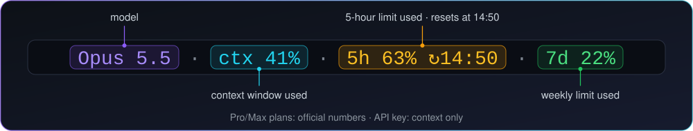
</div>

| Часть | Пример | Что значит |
|---|---|---|
| модель | `Opus 5.5` | Модель текущей сессии |
| контекст | `ctx 41%` | Насколько заполнено окно контекста |
| 5-часовой лимит | `5h 63% ↻14:50` | Какая доля 5-часового лимита израсходована; `↻` — местное время сброса |
| недельный лимит | `7d 22%` | Какая доля недельного лимита израсходована |
| ваша прежняя строка | `\| …` | Если у вас уже была строка состояния, её вывод дописывается после ` \| ` |

**Подписка Pro / Max:** части `5h` и `7d` появляются после первого ответа и показывают официальные цифры. **API-ключ:** будут модель и `ctx`; лимиты оцениваются по локальным транскриптам. Отключить строку позже можно командой `/orchestrator:setup remove` — она убирает из `settings.json` нашу строку состояния и записи хуков и возвращает вашу прежнюю строку; папка с данными `~/.claude/claude-orchestrator/` (калибровка, ваш необязательный `limits.json`) остаётся. После обновления плагина скопированные скрипты обновляются сами при следующем старте сессии.

<details>
<summary><b>Другие способы установки</b> — из терминала, для одного проекта или вручную</summary>

**A · Одна команда из терминала** (открывать Claude Code заранее не нужно). Делает то же, что шаг 3. 🖥️ В терминале:

```bash
claude plugin install orchestrator --marketplace newzealandgrom/claude-orchestrator
```

Только для текущего проекта — добавьте `--scope project` (по умолчанию область *user*: все ваши проекты):

```bash
claude plugin install orchestrator --marketplace newzealandgrom/claude-orchestrator --scope project
```

**B · Ручная установка** — вы сами копируете файлы, система плагинов не нужна. Понадобится `git`. 🖥️ В терминале:

```bash
git clone https://github.com/newzealandgrom/claude-orchestrator.git && cd claude-orchestrator && ./install.sh
```

| Параметр `./install.sh` | Что делает |
|---|---|
| *(без параметров)* | Ставит скилл и 27 агентов для вашего пользователя (`~/.claude`) |
| `--project <dir>` | Ставит только для одного проекта (`<dir>/.claude`) |
| `--statusline` | Дополнительно включает строку состояния |
| `--hooks` | Дополнительно регистрирует хуки лимитов, бюджета и чекпоинта (в установке плагином они уже встроены — не используйте оба варианта сразу) |
| `--statusline-only` | Только строка состояния (это же запускает `/orchestrator:setup`) |
| `--dry-run` | Показывает, что изменится, ничего не меняя |

При ручной установке главная команда без префикса: `/orchestrator <задача>`, `/orchestrator status`, `/orchestrator limits` и так далее. Перед любой правкой `settings.json` делается его резервная копия.

</details>

<details>
<summary><b>Не получилось?</b> — симптом → что делать</summary>

| Симптом | Что делать |
|---|---|
| `claude: command not found` | Claude Code не установлен или терминал ещё о нём не знает. Установите его (шаг 0), затем **закройте и снова откройте терминал**. |
| 💬 `/plugin` отвечает «unknown command» или `--marketplace` отвергается | Claude Code слишком старый. 🖥️ Выполните `claude update`, снова запустите `claude` и повторите. |
| Ошибка про marketplace, `git` или «failed to clone» | Проверьте интернет, VPN или прокси. Затем попробуйте полный URL: 💬 `/plugin marketplace add https://github.com/newzealandgrom/claude-orchestrator.git`, а следом `/plugin install orchestrator@claude-orchestrator`. |
| Плагин установлен, но команд `/orchestrator:…` нет | 💬 `/reload-plugins` или перезапустите Claude Code. Проверьте `/plugin` → **Installed**. |
| `python3: command not found` или Python старше 3.9 | macOS: `xcode-select --install` · Ubuntu / Debian / WSL: `sudo apt install python3` |
| В строке состояния нет `5h` / `7d` | Эти две части есть только на тарифах Pro/Max и появляются после первого ответа. С API-ключом показываются только модель и `ctx`. Убедитесь также, что при первом запуске вы подтвердили доверие к папке. |
| Я на Windows, и ничего не работает | Скрипты — это bash и Python, поэтому нужен **WSL** (шаг 1). Все шаги выполняйте внутри окна Ubuntu. |

</details>

### <a id="ru-first-run"></a>Первый запуск

Опишите задачу так, как объяснили бы коллеге. Запустить можно тремя равноценными способами.

**1 · Установка плагином** (обычный путь). Главная команда — `/orchestrator:orchestrator`:

```
/orchestrator:orchestrator почини падающие тесты в api/ и добавь покрытие
```

**2 · Ручная установка.** Команда без префикса:

```
/orchestrator почини падающие тесты в api/ и добавь покрытие
```

**3 · Обычными словами.** Работает при любой установке — Claude сам подключит скилл, если запрос подходит:

```
Оркестратор, почини падающие тесты в api/ и добавь покрытие
```

#### Что происходит на экране

Оркестратор по ходу работы коротко сообщает, что делает. Большая задача выглядит примерно так (это **иллюстрация** формы, а не настоящий вывод):

```text
вы   > /orchestrator:orchestrator добавь сброс пароля по e-mail: API-эндпоинт и веб-форма.
       Уложись в 25 % моего 5-часового лимита.

orch > Лимиты: режим normal. Размер L (бэкенд + веб, затрагивает auth) - полный цикл.
       Разведка: три разведчика (haiku) параллельно картографируют бэкенд/auth, веб-форму и тесты.
orch > План сохранён в .claude/plans/2026-05-04-password-reset.md
       1. architect    ревью этого плана                           best / high
       2. dev-senior   API: токен, эндпоинт, срок действия         opus / high
       3. dev-senior   веб-клиент: форма и состояния               opus / high   параллельно с 2
       4. build-verifier, reviewer, security проверяют оба диффа
       5. tech-writer  документация
       Бюджет: 25 % 5-часового лимита. Прод не затрагивается. Продолжаю.
...
orch > reviewer: на доработку - нет случая с просроченным токеном -> возвращено тому же разработчику
orch > reviewer (раунд 2): принято. security: принято.

orch > Отчёт
       Изменено:   файлы и что в каждом поменялось
       Проверено:  сборка и тесты проходят; reviewer и security приняли
       Осталось:   формулировку письма нужно решить вам
```

Что полезно знать:

- План — обычный файл `.claude/plans/YYYY-MM-DD-<slug>.md`. Открыть его можно в любой момент.
- Оркестратор отвечает на **вашем языке**.
- Мелкие задачи (≤ 2 файлов, очевидные) он просто делает сам — без команды и ожидания.
- Он останавливается и спрашивает только перед необратимым или «наружным»: деплой, push, публикация, удаление.
- `/orchestrator:status` показывает, как идут дела; `/orchestrator:resume` продолжает после паузы.

### <a id="ru-examples"></a>Примеры

Вводите любой из них после `/orchestrator:orchestrator` или обычными словами: *«Оркестратор, …»*. Колонка **Плейбук** — готовый рецепт, от которого отталкивается план (все 12 расписаны в [`playbooks.md`](skills/orchestrator/references/playbooks.md)). В последней колонке `→` значит «затем», а `∥` — «одновременно»; порядок оркестратор подстраивает под вашу задачу.

#### Повседневная работа

| # | Вы говорите | Плейбук | Что делает оркестратор |
|---|---|---|---|
| 1 | *«Пользователи получают ошибку 500 при пустой корзине — найди причину, исправь и добавь регрессионный тест»* | `bugfix` | Размер **M**. `scout` картографирует путь сбоя и способ воспроизведения → `test-engineer` сначала пишет падающий регрессионный тест → `dev-middle` (или `dev-senior`, если ошибка пересекает модули) делает минимальное исправление → `build-verifier` ∥ `reviewer` проверяют |
| 2 | *«Добавь сброс пароля по e-mail: API-эндпоинт и веб-форма. Не деплой.»* | `feature` | Размер **L**. `scout` по областям ∥ → `analyst` пишет проверяемые критерии приёмки → `architect` ∥ `api-designer` фиксируют дизайн и контракт → `db-engineer` (миграция + откат, если меняется схема) → бэкенд-разработчик ∥ `frontend` ∥ `test-engineer` → `build-verifier` → `reviewer` ∥ `security` и `privacy-compliance` (auth, персональные данные) ∥ `accessibility` (UI) → `qa` ∥ `tech-writer`. «Не деплой» отсекает последний шаг |
| 3 | *«Разбей 2000-строчный OrderService на модули, не меняя поведение»* | `refactor` | `scout` перечисляет вызывающих и публичную поверхность → `test-engineer` сначала фиксирует нынешнее поведение тестами → `architect` режет работу на малые упорядоченные шаги → `dev-senior` переносит код по одному шагу, после каждого `build-verifier` → `reviewer` проверяет весь дифф: поведение и публичный API не изменились |
| 4 | *«Подними покрытие тестами модуля биллинга — сначала граничные случаи — и почини нестабильные тесты»* | `test-coverage` | `build-verifier` фиксирует базовую линию → `scout` ранжирует непокрытые модули по риску → `test-engineer` пишет недостающие тесты по модулям (только тесты — найденные баги продукта становятся шагами bugfix) и ловит нестабильные → `build-verifier` ∥ `reviewer` (проверяют ли тесты поведение?); изменение покрытия сообщается |
| 5 | *«Эндпоинт /search отвечает 4 секунды. Разберись, почему, и доведи p95 до секунды; покажи до и после»* | `performance` | `scout` находит горячие пути и способ измерения → `performance` снимает базовый замер (несколько прогонов) и согласует с вами цель → по одному изменению за раз (`performance`, а для запросов `db-engineer`) → `build-verifier` ∥ `reviewer` → `performance` выкладывает таблицу «до / после» |
| 6 | *«Почини все находки npm audit, до которых реально достаёт наш код, а затем подними React с 17 до 18»* | `dependency-upgrade` | `dependency-auditor` ранжирует пакеты по риску и достижимости → `build-verifier` фиксирует базовую линию → `researcher` читает changelog крупных обновлений (со ссылками) → `dev-middle` обновляет по одной группе пакетов — сначала патчи, по одному major за шаг — а `test-engineer` закрывает непокрытое поведение → `reviewer` проверяет дифф lock-файла |
| 7 | *«Проверь оформление заказа на доступность (WCAG) и исправь блокирующие проблемы»* | — | `accessibility` проверяет (WCAG 2.2 AA, клавиатура, контраст, скринридеры; только чтение) → `frontend` исправляет блокеры → `build-verifier` → `reviewer` |
| 8 | *«Напиши README (установка, настройка, решение проблем), который соответствует тому, что код делает на самом деле»* | `docs` | `scout` картографирует, что есть на самом деле → `analyst` перечисляет расхождения старых доков с кодом → `tech-writer` пишет, привязывая каждое утверждение к коду → `build-verifier` выполняет все описанные команды и проверяет ссылки → `reviewer` пытается опровергнуть утверждения |
| 9 | *«Мне достался чужой репозиторий. Объясни, что он делает, как его запустить и что в нём рискованного. Ничего не меняй.»* | `onboarding` | `build-verifier` пробует установить, собрать, протестировать и запустить (ничего не исправляя) → `scout` по верхнеуровневым областям ∥ → `analyst` перечисляет противоречия и рискованные места → `tech-writer` записывает карту в `.claude/orchestrator/project-map.md` |

#### Крупное или рискованное

| # | Вы говорите | Плейбук | Что делает оркестратор |
|---|---|---|---|
| 10 | *«Проведи ревью безопасности модуля авторизации и публичного API»* | `security-audit` | `scout` картографирует поверхность атаки → `security` ∥ `protocol-reviewer` ∥ `privacy-compliance` ∥ `dependency-auditor`, у каждого свой взгляд → дубликаты убираются → критичные находки проверяет **панель из 3 ревьюеров**, пытающихся их опровергнуть → подтверждённые находки становятся исправлениями, каждое со вторым кругом ревью → `tech-writer` фиксирует, что проверено, а что нет |
| 11 | *«Раздели users.full_name на имя и фамилию в таблице на 20 млн строк без простоя. Сначала покажи план.»* | `migration` | `db-engineer` планирует «расширить → заполнить пачками → переключить чтение → сжать», с откатом на каждой фазе, проверенным up → down → up на одноразовой копии → разработчик пишет переходный код → `reviewer` ∥ `build-verifier` → `devops` делает снимок (только чтение) и планирует бэкап и откат → **ждёт вашего «да»** → `devops` выполняет (разрушительная фаза «сжать» получает отдельное «да») |
| 12 | *«Прод отвечает 502 на все запросы с 14:20. Выясни причину и предложи самое безопасное исправление — перед любыми действиями на сервере спроси.»* | `incident` | `incident-responder` ∥ `devops` (снимок только для чтения) ∥ `scout` (недавние изменения) → ранжированные гипотезы и варианты смягчения, у каждого свой откат → **ваше «да»** → `devops` применяет только одобренный список → `incident-responder` проверяет восстановление → `tech-writer` набрасывает постмортем; исправление первопричины идёт следом как bugfix |
| 13 | *«Подготовь релиз 1.4.0: версия, changelog, проверки. Покажи команды публикации, но не выполняй их.»* | `release` | `release-manager` выбирает версию (semver) и пишет changelog и заметки → `build-verifier` (полная матрица) ∥ `dependency-auditor` (CVE, лицензии) → `qa` прогоняет smoke-тест на собранных артефактах → обновляются файлы версий и документация → показываются точные команды публикации и откат → **ваше «да»** → публикуют `release-manager` / `devops` |
| 14 | *«Добавь переключатель тёмной темы в вебе, Android и iOS»* | `feature` (кросс-платформенная) | `scout` по платформам ∥ → `architect` пишет спеку → разработчики по платформам ∥ (отдельные git worktree, если у них одно дерево сборки) → `build-verifier` → ревьюеры ∥ (плюс `protocol-reviewer`, если затронуты wire-форматы или крипто) → раунды правок |
| 15 | *«Хотим добавить Terraform — какие инструменты и плагины взять?»* | — | `toolsmith` ∥ `researcher` находят и проверяют плагины, скиллы и MCP-серверы, с источниками. Они рекомендуют, но ничего не устанавливают |
| 16 | *«Включи gzip в конфиге nginx на проде»* | — (гейт на прод) | `devops` снимает состояние (только чтение) → `security` говорит, что это закрывает или ломает → **ваше явное «да»** → `devops` с `OWNER_APPROVED: yes` и точным списком действий → проверки после изменения |

#### Управление уже идущей работой

| Вы вводите | Что получаете |
|---|---|
| `/orchestrator:status` | Дашборд не длиннее 12 строк: ход плана, агенты в работе, следующий шаг, решения, ждущие вас, лимиты, расход против бюджета |
| `/orchestrator:limits` | Отчёт о лимитах с объяснением: режим, состояние каждой модели, заполнение контекста, время сброса и что оркестратор по этому поводу сделает |
| `/orchestrator:costs` | Токены по ролям и агентам, главные потребители, бюджет плана и один совет, как сэкономить |
| `/orchestrator:resume` | Продолжить текущий план с чекпоинта после `/compact`, `/clear`, перезапуска или сброса лимита |

**Ещё:** [`examples/README.md`](examples/README.md) — оглавление · [`examples/prompts.md`](examples/prompts.md) — 30+ готовых запросов · [`examples/sessions/`](examples/sessions/) — три разобранных прогона: [bugfix](examples/sessions/01-bugfix.md), [feature](examples/sessions/02-feature.md), [аудит безопасности](examples/sessions/03-security-audit.md) · [`examples/plan-feature.md`](examples/plan-feature.md) — пример плана · [`examples/brief-bugfix.md`](examples/brief-bugfix.md) — пример брифа агенту · [`examples/outputs/`](examples/outputs/) — примеры вывода отчётов о лимитах, расходах и статусе.

### <a id="ru-how"></a>Как это работает

#### Цикл работы

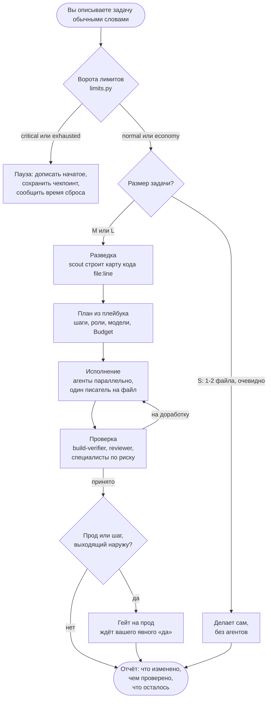

| Размер задачи | Признаки | Что происходит |
|---|---|---|
| **S** | ≤ 2 файлов, очевидная правка, ничего про безопасность, прод или протоколы | Оркестратор делает сам — без агентов |
| **M** | 2–6 шагов в 1–2 областях | Короткий план, 2–5 агентов, проверка |
| **L** | Несколько платформ или сервисов, протокол или безопасность, прод, пачка находок аудита, новая функция | Полный цикл; сначала план смотрит архитектор |

Правила, по которым он работает:

- **Собственный контекст — самое дорогое.** Чтение и правки отданы агентам; сам он работает с короткими отчётами вида `file:line — факт`.
- **Один писатель на файл.** Параллельные писатели в одном дереве сборки получают отдельные git worktree.
- **Сначала самая дешёвая подходящая модель.** При неудаче следующий уровень получает тот же бриф плюс причину.
- **«Готово» не принимается на слово разработчику.** См. лестницу ниже.
- **Возобновлять, а не ставить задачу заново.** Завершённого или прерванного агента продолжают через `SendMessage`, и он сохраняет свой контекст.
- **Ничего «наружного» без вашего «да».**

<details>
<summary><b>Лестница проверок</b> — кто что проверяет</summary>

| Изменение затрагивает | Проверяет |
|---|---|
| что угодно | `build-verifier` — сборка, тесты, линтеры |
| код от middle- и senior-разработчиков | `reviewer` — adversarial: пытается опровергнуть «готово», запускает сборку |
| крипто, токены, wire-форматы, совместимость | `protocol-reviewer` |
| auth, периметр, rate limits, конфигурация прода | `security` |
| пользовательские сценарии, новый UI | `qa` (и `accessibility` для UI) |
| поведение изменилось, а тестов нет | `test-engineer` |
| персональные данные собираются, логируются или передаются | `privacy-compliance` |
| «горячие» пути | `performance` |
| меняются зависимости | `dependency-auditor` |
| критичные находки | **панель опровержения** из 3 независимых ревьюеров; принимается, если согласны минимум двое |

Вердикт «на доработку» возвращается **тому же** разработчику (контекст сохраняется), и перепроверяются только исправления.

</details>

#### Режимы лимитов

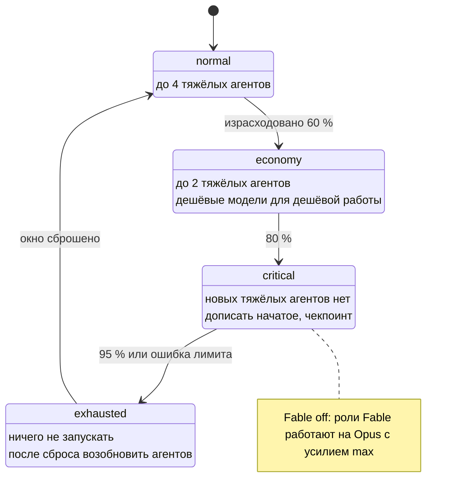

Режим следует за расходом: после сброса окна процент падает, и режим снова смягчается к `normal`.

#### Жизненный цикл контекста

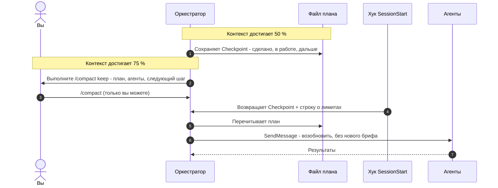

#### Состав команды

<div align="center">
</div>

<a id="ru-roles"></a>

<details>
<summary><b>Вся команда — все 27 ролей</b> (нажмите, чтобы открыть)</summary>

`best` = Fable, если он есть у вашего аккаунта, иначе Opus. 🆕 = новое в 2.0. Роль с «нет» в колонке **Правит** работает только на чтение: инструменты редактирования у неё отключены.

| Группа | Роль | Агент | Модель / усилие | Правит | Когда вызывается |
|---|---|---|---|---|---|
| Lead | Архитектор / техлид | `orch-architect` | best / high | нет | ревью плана или спеки для задач L; второе мнение; судья |
| Lead | Аналитик | `orch-analyst` | sonnet / high | нет | размытый запрос → требования и критерии приёмки; расхождения документации и кода |
| Lead | 🆕 Исследователь | `orch-researcher` | sonnet / medium | нет | вопросы, где нужен веб: библиотеки, стандарты, аналоги — с источниками |
| Build | Senior-разработчик | `orch-dev-senior` | opus / high | код | сквозные, протокольные, конкурентные, многомодульные изменения |
| Build | Middle-разработчик | `orch-dev-middle` | sonnet / medium | код | чётко описанное изменение в одном модуле |
| Build | Junior-разработчик | `orch-dev-junior` | haiku / medium | код | точный diff, переименования, механические правки |
| Build | 🆕 Frontend-разработчик | `orch-frontend` | sonnet / medium | код | веб-интерфейс: компоненты, состояние, формы, состояния экранов, адаптивность |
| Build | 🆕 Mobile-разработчик | `orch-mobile` | opus / medium | код | iOS / Android: жизненный цикл, разрешения, защищённое хранилище, паритет платформ |
| Build | 🆕 Инженер БД | `orch-db-engineer` | opus / medium | миграции, запросы | схемы, безопасные миграции с откатом, индексы, планы запросов |
| Build | 🆕 Проектировщик API | `orch-api-designer` | sonnet / high | спеки | контракты, модель ошибок, версионирование, совместимость — до кода |
| Build | Дизайнер | `orch-designer` | opus / medium | стили, компоненты | экраны, дизайн-токены, микротексты |
| Quality | Adversarial-ревьюер | `orch-reviewer` | opus / high | нет | каждый шаг разработки; пытается опровергнуть «готово», запускает сборки |
| Quality | 🆕 Тест-инженер | `orch-test-engineer` | sonnet / medium | тесты | недостающие тесты, пробелы покрытия, нестабильные тесты, тест-векторы |
| Quality | QA / голос пользователя | `orch-qa` | sonnet / medium | нет | сценарии, smoke-чеклисты, UX-ловушки, ложные обещания в интерфейсе |
| Quality | 🆕 Инженер по производительности | `orch-performance` | opus / high | код | измеряемая оптимизация: профили, бенчмарки, N+1, утечки |
| Quality | 🆕 Ревьюер доступности | `orch-accessibility` | sonnet / medium | нет | WCAG 2.2 AA, скринридеры, контраст, клавиатура, масштаб текста |
| Quality | Build verifier | `orch-build-verifier` | haiku / low | нет | запускает перечисленные команды, PASS / FAIL + строки ошибок |
| Security | Безопасность / пентест | `orch-security` | best / high | нет | модель угроз, auth, периметр, rate limits, подтверждение находок |
| Security | Ревьюер протоколов / крипто | `orch-protocol-reviewer` | best / high | нет | крипто, auth-токены, wire-форматы, кросс-платформенная совместимость |
| Security | 🆕 Инженер по приватности | `orch-privacy-compliance` | sonnet / high | нет | карта персональных данных, PII в логах, политика против фактического поведения |
| Security | 🆕 Аудитор зависимостей | `orch-dependency-auditor` | sonnet / medium | нет | CVE с учётом достижимости, устаревшие и заброшенные пакеты, лицензии |
| Ops | DevOps / SRE | `orch-devops` | opus / medium | инфра-файлы | снимки, планы деплоя с откатом; прод — только с `OWNER_APPROVED: yes` |
| Ops | 🆕 Дежурный по инцидентам | `orch-incident-responder` | opus / high | нет | прод сломан: триаж, гипотезы, безопасное смягчение |
| Ops | 🆕 Релиз-менеджер | `orch-release-manager` | sonnet / medium | версия, changelog | повышение semver, release notes, чеклист; публикует только с одобрения |
| Support | Scout (разведчик) | `orch-scout` | haiku / low | нет | карты `file:line`; навигация по огромным документам |
| Support | Технический писатель | `orch-tech-writer` | sonnet / medium | документация | README, changelog, runbook — каждое утверждение сверяется с кодом |
| Support | Toolsmith | `orch-toolsmith` | sonnet / medium | нет | ищет и проверяет плагины, скиллы, MCP, LSP под задачу; сам ничего не ставит |

При установке плагином агентов вызывают как `orchestrator:orch-<role>`, при ручной установке — как `orch-<role>`. Типовые составы команд — в [`roles.md`](skills/orchestrator/references/roles.md).

</details>

### <a id="ru-limits"></a>Лимиты, контекст и расходы

<div align="center">
</div>

Перед каждой волной агентов оркестратор запускает `limits.py` (около секунды, локально, только чтение) и **выполняет `actions`, которые тот печатает**. Тот же отчёт можно прочитать в любой момент командой `/orchestrator:limits`. Схема режимов нарисована [выше](#ru-how).

#### Четыре режима

| Режим | Когда | Что меняется |
|---|---|---|
| 🟢 **normal** | ниже 60 % самого тесного окна | До 4 тяжёлых (Opus / Fable) агентов параллельно; полная лестница проверок |
| 🟡 **economy** | от 60 % | До 2 тяжёлых агентов; Haiku для поиска и сборок, Sonnet для анализа и документации; ревью только рискованных диффов; без панелей опровержения |
| 🟠 **critical** | от 80 % | Новых тяжёлых агентов нет; дописывает начатое, сохраняет чекпоинт, сообщает, что сделано, что осталось и когда сбросится лимит |
| 🔴 **exhausted** | от 95 % или активная ошибка лимита | Ничего не запускает; сохраняет чекпоинт; после сброса возобновляет агентов через `SendMessage` — бриф заново не пишет |

#### Когда одна модель на исходе

| Статус | Условие | Что делает оркестратор |
|---|---|---|
| Fable `economy` | недельная доля Fable ≥ 60 % | Fable используется только как судья критичных решений; остальные его роли работают на Opus с усилием `max` |
| Fable `off` | ошибка лимита Fable, недельная доля Fable ≥ 85 % или сессия в `critical` | **Все роли Fable / `best` работают на Opus с усилием `max`** |
| Opus `off` | ошибка лимита Opus | Senior-роли переходят на Sonnet с усилием `high` |
| Sonnet `off` | ошибка лимита Sonnet | Анализ и документация уходят на Haiku `high` или Opus `medium` |

Недельная доля модели учитывается, только если для неё известен потолок — из `model_weekly_cap_units` в конфиге или из записанного сообщения о лимите этой модели. Иначе её процент показывается как `n/a`, и сдвинуть статус могут только уровень сессии или настоящая ошибка лимита.

#### Откуда берутся цифры (от лучшего к худшему)

1. 🎯 **Официальные цифры из строки состояния** — Pro/Max: `used_percentage` за 5 часов и 7 дней и время сброса; у всех: процент контекста. Используются, пока им меньше 10 минут.
2. 📜 **Ваши локальные транскрипты** (`~/.claude/projects/**`, включая субагентов) — переводятся во взвешенные «единицы использования».
3. ⚠️ **Настоящие ошибки лимитов**, которые записывает Claude Code (`You've hit your … limit · resets …`, `You've used 85% of …`). По ним калибруются потолки.
4. 🧠 **Самокалибровка.** Пока официальные цифры свежие, плагин запоминает, сколько единиц составляют 1 % каждого лимита, и применяет этот масштаб, когда снимок устарел (`cap: calibrated`). Это приближение между обновлениями строки состояния; свежие официальные цифры всегда важнее.
5. ⚙️ **Ваш конфиг** `~/.claude/claude-orchestrator/limits.json` — необязателен, см. [Настройку](#ru-config).

Всё, кроме официальных цифр, — **оценка**: расход с других устройств и из claude.ai локально не виден. Пока не встретился настоящий лимит (и нет официальных цифр), потолок — лишь догадка (самый большой прошлый блок), поэтому высокий процент сообщается на уровень мягче.

<details>
<summary>Сырой вывод limits.py</summary>

```text
mode: ECONOMY
session 5h: 28961327 / 45970360 units (63%, cap: statusline), block 2026-05-04T09:50:00+00:00 -> 2026-05-04T14:50:00+00:00
week 7d:    54933023 / 249695560 units (22%)
model fable   economy  week 21304118 / 30005800 (71%)
model haiku   ok       week 559344 / ? (n/a)
model opus    ok       week 28131516 / ? (n/a)
model sonnet  ok       week 4407242 / ? (n/a)
context: 412880 / 1000000 tokens (41%) -> ok  [3f2a9c1e-….jsonl]
calibration 5h: 1% ≈ 459704 units (learned at 63%, 2026-05-04T12:31Z)
calibration 7d: 1% ≈ 2496956 units (learned at 22%, 2026-05-04T12:31Z)
source: statusline+transcripts
actions:
  - ECONOMY: max 2 parallel heavy agents; no refute panels; prefer haiku for search/build, sonnet for analysis; reviews only for risky changes.
  - FABLE ECONOMY: use fable only as judge for critical/protocol decisions; other fable roles -> opus, effort max.
```

</details>

#### Контекст

Модель не может сама выполнить `/compact` или `/clear` — это можете только вы. Поэтому оркестратор бережёт свой контекст и действует по уровню заполнения:

| Заполнение контекста | Что он делает |
|---|---|
| ниже 50 % | Ничего особенного |
| от **50 %** | Переписывает `## Checkpoint` плана (сделано, id работающих агентов, следующий шаг, открытые решения) и сам больше не читает файлы |
| от **75 %** | Сохраняет чекпоинт и просит вас выполнить `/compact keep: plan <path>, running agents, next step` |
| после `/compact`, `/clear` или перезапуска | Хук `SessionStart` возвращает модели чекпоинт и строку о лимитах; оркестратор продолжает по фактам, а не по сжатому пересказу |

#### Расходы и бюджеты

`/orchestrator:costs` превращает те же транскрипты в счёт **по ролям и по агентам**:

```text
Costs — session 3f2a9c1e · since 2026-05-04 09:52Z · 412 responses
  total: 61.2M tokens · 8.47M units · ≈ 18.4% of the 5-hour limit · ≈ 3.4% of the week

  role                         agents   model   tokens    units   ≈5h %  share
  orchestrator (main)               1    opus    24.1M    3.52M    7.7%    42%
  orch-dev-senior                   2    opus    19.8M    2.61M    5.7%    31%
  orch-reviewer                     2    opus    9.40M    1.37M    3.0%    16%
  orch-tech-writer                  1  sonnet    3.10M   402.5k    0.9%     5%
  orch-security                     1   fable   1.20M    388.0k    0.8%     5%
  orch-scout                        3   haiku    3.60M   121.0k    0.3%     1%
  orch-build-verifier               2   haiku   0.20M    14.2k     0.0%     0%

  top agents:
    orch-dev-senior        a3de429a5d    1.52M units  opus   API + web client for password reset
    orch-reviewer          a0bfb4ae2d    0.81M units  opus   Review backend changes

  budget (2026-05-04-password-reset.md, all sessions since 2026-05-04 16:50): 25% of the 5-hour limit → spent 18.4% = 74% → OK
```

**Бюджеты планов.** В заголовке каждого плана есть строка `Budget:`. Оркестратор отталкивается от бюджетной подсказки плейбука (например, средний bugfix — 2–6 %, крупная фича — 20–40 % 5-часового лимита); свою цифру можно назвать в запросе или в любой момент поправить строку.

| Строка в заголовке | Что значит |
|---|---|
| `Budget: 25%` | 25 % 5-часового лимита |
| `Budget: 4M tokens` | 4 миллиона токенов |
| `Budget: 2.5M units` | 2,5 миллиона единиц использования |

Расход считается по **всем сессиям проекта** с момента `Started:`. Хук бюджета предупреждает **один раз на 80 %**, а **на 100 % новые агенты уже не запускаются**. Например:

```text
[orchestrator budget] plan .claude/plans/2026-05-04-password-reset.md: 82% of the budget (25% of the 5-hour limit) spent. Prefer cheaper models, avoid optional reviews and scope growth; tell the user if the rest will not fit.
```

#### Что запускается автоматически

Плагин поставляет четыре хука на трёх событиях. Пока всё в порядке, они **молчат** и никогда не ломают сессию.

| Когда | Что делает |
|---|---|
| Стартует сессия | Обновляет стабильную копию скриптов (только если вы настроили строку состояния) |
| После `/compact`, `/clear` или resume | Возвращает чекпоинт плана и строку о лимитах |
| После запуска или завершения агента | Добавляет указание по лимитам, только когда состояние изменилось; предупреждает о бюджете плана на 80 % / 100 % |
| Вы отправляете запрос | Добавляет указание по лимитам (кэшируется на 120 секунд), только когда состояние изменилось |

Сообщение о лимитах выглядит так:

```text
[orchestrator limits] mode=economy session=63% week=22% context=41% models=fable:economy,haiku:ok,opus:ok,sonnet:ok :: ECONOMY: max 2 parallel heavy agents; … | FABLE ECONOMY: …
```

Подробнее: [docs/ru/limits-and-context.md](docs/ru/limits-and-context.md).

### <a id="ru-commands"></a>Команды

| Установка плагином | Ручная установка | Что делает |
|---|---|---|
| `/orchestrator:orchestrator <задача>` | `/orchestrator <задача>` | **Главная команда.** План → делегирование → проверка → отчёт |
| `/orchestrator:status` | `/orchestrator status` | Дашборд: ход плана, работающие агенты, следующий шаг, лимиты, расход против бюджета |
| `/orchestrator:limits` | `/orchestrator limits` | Отчёт о лимитах с объяснением |
| `/orchestrator:costs` | `/orchestrator costs` | Токены по ролям и агентам, главные потребители, бюджет, один совет по экономии |
| `/orchestrator:resume` | `/orchestrator resume` | Продолжить текущий план после `/compact`, `/clear`, перезапуска или сброса лимита |
| `/orchestrator:setup` | `./install.sh --statusline` | Включить строку состояния (один раз) |
| `/orchestrator:setup remove` | `./uninstall.sh` | Снова убрать нашу строку состояния и записи хуков (данные и `limits.json` остаются). Ручной `./uninstall.sh` удаляет всю ручную установку |

Короткие команды вводите вы сами — Claude сам их не запускает. `/orchestrator:status` заканчивается примерно так (вывод `checkpoint.py --status`):

```text
[orchestrator] status — plan .claude/plans/2026-05-04-password-reset.md (in-progress)
progress: 4 done · 2 in progress · 3 to do  ■■■■◧◧□□□ 44%
```

#### Скрипты

Команды выше — тонкие обёртки над небольшими скриптами на Python и bash. Их можно запускать и самому. Они лежат в папке скилла (`skills/orchestrator/scripts/`); после `/orchestrator:setup` копии `limits.py`, `costs.py`, `checkpoint.py` и `statusline.py` есть и в `~/.claude/claude-orchestrator/`.

| Скрипт | Что делает | Полезные параметры |
|---|---|---|
| `python3 limits.py` | Отчёт о лимитах | `--json` · `--hook <Event>` · `--config FILE` · `--context-window N` |
| `python3 costs.py` | Отчёт о расходах текущей сессии | `--session <id>` · `--project-wide --since <ISO>` · `--plan <plan.md>` · `--active-plan --budget-only` · `--top N` · `--json` · `--hook PostToolUse` |
| `python3 checkpoint.py` | Печатает чекпоинт текущего плана | `--status` (дашборд) · `--hook` |
| `spawn.sh <agent> <brief> --mode …` | Запускает агента в **отдельном процессе `claude`** с чистым контекстом | `--mode headless\|terminal\|tmux\|interactive` · `--model …` · `--effort …` · `--id` · `--max-turns` · `--schema` · `--perm` · `--cwd` |
| `collect.sh [run-id …]` | Собирает результаты этих запусков (по умолчанию 20 последних) | `--wait` · `--full` |

Например, ревью на чистом контексте на Opus с максимальным усилием (при ручной установке скрипты лежат в `~/.claude/skills/orchestrator/scripts`):

```bash
echo "Review api/auth.py:10-120 and report problems as file:line" | ~/.claude/skills/orchestrator/scripts/spawn.sh orch-reviewer - --model opus --effort max
```

Режим `headless` работает в фоне и пишет в `.claude/runs/<run-id>/`; `terminal` и `interactive` открывают окно macOS Terminal; `tmux` открывает окно в сессии tmux с именем `orch`.

### <a id="ru-config"></a>Настройка

Всё работает и с настройками по умолчанию. Чтобы их изменить, создайте файл `~/.claude/claude-orchestrator/limits.json` (если задана `$CLAUDE_CONFIG_DIR`, она заменяет `~/.claude`). Меняются только те ключи, которые вы указали, остальные остаются по умолчанию. Полный шаблон — [`examples/limits.example.json`](examples/limits.example.json):

```json
{
  "session_cap_units": null,
  "weekly_cap_units": null,
  "model_weekly_cap_units": { "fable": null, "opus": null },
  "model_weights": { "fable": 2.0, "opus": 1.0, "sonnet": 0.6, "haiku": 0.2, "other": 1.0 },
  "thresholds": { "economy": 0.60, "critical": 0.80, "exhausted": 0.95 },
  "model_thresholds": { "economy": 0.60, "off": 0.85 },
  "context_window": null,
  "context_thresholds": { "checkpoint": 0.50, "compact": 0.75 }
}
```

| Ключ | Что значит |
|---|---|
| `session_cap_units` | Задать потолок 5-часового окна самому (в единицах использования) вместо оценки |
| `weekly_cap_units` | То же для недельного потолка |
| `model_weekly_cap_units` | Недельный потолок по семейству моделей, например `{ "fable": 5000000 }` |
| `model_weights` | Относительный «вес» стоимости семейства моделей: Fable 2.0, Opus 1.0, Sonnet 0.6, Haiku 0.2 |
| `thresholds` | С каких долей лимита начинаются `economy`, `critical` и `exhausted` |
| `model_thresholds` | С каких долей недельного потолка одна модель переходит в `economy` и `off` |
| `context_window` | Размер контекста в токенах; при `null` определяется автоматически |
| `context_thresholds` | Где происходят чекпоинт (`0.50`) и просьба о `/compact` (`0.75`) |

Пример — более осторожный оркестратор с зафиксированным 5-часовым потолком:

```json
{
  "session_cap_units": 40000000,
  "thresholds": { "economy": 0.50, "critical": 0.70, "exhausted": 0.90 }
}
```

#### Переменные окружения

| Переменная | Кто читает | Что значит |
|---|---|---|
| `ORCH_LIMITS_CONFIG` | `limits.py`, `costs.py` | Путь к конфигу лимитов вместо файла по умолчанию |
| `ORCH_STATUSLINE_NEXT` | `statusline.py` | Команда другой строки состояния, которую нужно сохранить; её вывод дописывается после ` \| `. Установщик заполняет её сам, если у вас уже была строка состояния |
| `ORCH_RUNS` | `spawn.sh`, `collect.sh` | Папка для запусков агентов с чистым контекстом (по умолчанию `<project>/.claude/runs`) |
| `ORCH_PERM` | `spawn.sh` | Режим разрешений для запущенных агентов по умолчанию (`acceptEdits`) |
| `ORCH_WAIT_MAX` | `collect.sh` | Сколько секунд максимум ждёт `collect.sh --wait` (по умолчанию 1800) |
| `CLAUDE_AUTOCOMPACT_PCT_OVERRIDE` | сам Claude Code | Снижает процент заполнения контекста, при котором Claude Code делает авто-компактизацию. К плагину не относится |

### <a id="ru-faq"></a>FAQ

<details>
<summary><b>У меня нет доступа к Fable. Заработает ли?</b></summary>

Да, ничего делать не нужно. `best` означает «Fable, если он есть у вашего аккаунта, иначе Opus». Переключение Fable → Opus нужно только тем, у кого Fable есть.

</details>

<details>
<summary><b>Подписка или API-ключ — в чём разница?</b></summary>

С **подпиской Pro / Max** строка состояния показывает *официальные* проценты за 5 часов и за неделю, оркестратор использует их (и калибруется по ним). С **API-ключом** цифры за 5 часов и неделю — *оценки* по вашим локальным транскриптам; процент контекста точен в обоих случаях.

</details>

<details>
<summary><b>Не уйдёт ли больше токенов, чем без него?</b></summary>

Планирование и проверка чего-то стоят, но устройство плагина тянет в обратную сторону: дешёвые модели делают дешёвую работу (scout и проверки сборки на Haiku), основной чат не читает файлы (агенты возвращают короткие отчёты), мелкие задачи делаются сразу без команды, у планов есть бюджеты, а режим `economy` урезает работу, когда лимиты поджимают. Примерные цифры на агента (из [`model-routing.md`](skills/orchestrator/references/model-routing.md)): scout 5–50 тыс. токенов, build-verifier 5–30 тыс., junior 10–30 тыс., middle 30–100 тыс., senior 60–500 тыс., reviewer 40–300 тыс., architect / protocol / security 60–300 тыс. План из пяти шагов разработки с полной проверкой: 0,5–1,5 млн; кросс-платформенное изменение протокола с раундами ревью: 3–7 млн. Сколько потрачено на самом деле, покажет `/orchestrator:costs`.

</details>

<details>
<summary><b>Что-нибудь отправляется куда-то наружу?</b></summary>

Скрипты **локальные**: они только читают из транскриптов Claude Code счётчики токенов, id моделей, время и тексты ошибок лимитов, а небольшие файлы состояния пишут в `~/.claude/claude-orchestrator/`. Сетевого кода в них нет, телеметрии нет. Сами агенты — обычные субагенты Claude Code: они обращаются к API Anthropic как любая сессия, а у нескольких ролей (например, `orch-researcher` и `orch-toolsmith`) есть веб-инструменты.

</details>

<details>
<summary><b>Можно добавить свои роли?</b></summary>

Да. Создайте файл агента — `agents/orch-<name>.md` в клоне или файл в `.claude/agents/` своего проекта — с тем же frontmatter, что у встроенных (`name`, `description`, `model`, `effort`, `tools`). Затем назовите роль в запросе («для SQL-части используй агента `db-tuner`») или добавьте строку в [`roles.md`](skills/orchestrator/references/roles.md), чтобы оркестратор учитывал её каждый раз.

</details>

<details>
<summary><b>Можно использовать только в одном проекте?</b></summary>

Да. В терминале добавьте `--scope project` (`claude plugin install orchestrator --marketplace newzealandgrom/claude-orchestrator --scope project`), а при ручной установке выполните `./install.sh --project <dir>`.

</details>

<details>
<summary><b>Он сам выполняет /compact?</b></summary>

Нет — `/compact` и `/clear` можете выполнить только вы, модель не умеет. Оркестратор сохраняет чекпоинт на 50 %, на 75 % просит вас (с готовой строкой `keep:`), а после хук возвращает чекпоинт на место.

</details>

<details>
<summary><b>Что такое «единицы» (units)?</b></summary>

Взвешенный подсчёт токенов для сравнения расхода у разных моделей: `units = вес модели × (input + 5 × output + 0,1 × cache read + 1,25 × cache write 5m + 2 × cache write 1h)`. Веса по умолчанию: Fable 2.0, Opus 1.0, Sonnet 0.6, Haiku 0.2. Проценты, которые вы видите, — доли лимита; единицы нужны, только если вы фиксируете потолки в конфиге.

</details>

<details>
<summary><b>А Windows?</b></summary>

Используйте WSL (Ubuntu): скрипты написаны на bash и Python 3. См. шаг 1 установки. Claude Code и плагин запускайте внутри окна Ubuntu.

</details>

<details>
<summary><b>Я пользовался v1 («Team Orchestrator»). Что изменилось?</b></summary>

Плагин переименован в `orchestrator`, команда выросла с 15 до 27 ролей, появились короткие команды, плейбуки, учёт расходов с бюджетами и самокалибровка. Команда `/team-orchestrator` теперь называется `/orchestrator:orchestrator` (плагин) или `/orchestrator` (ручная установка). Шаги перехода — сразу ниже.

</details>

### <a id="ru-update"></a>Обновление · Удаление · Переход с v1

#### Обновление

💬 В Claude Code обновите каталог (marketplace), затем плагин (или воспользуйтесь меню `/plugin`):

```
/plugin marketplace update claude-orchestrator
```

```
/plugin update orchestrator@claude-orchestrator
```

🖥️ Или из терминала:

```bash
claude plugin update orchestrator@claude-orchestrator
```

Ручная установка — в клоне репозитория (с теми же параметрами, что и раньше):

```bash
git pull && ./install.sh
```

#### Удаление

**1.** Сначала отключите строку состояния. 💬 В Claude Code (это уберёт из `~/.claude/settings.json` строку состояния и записи хуков Orchestrator и вернёт вашу прежнюю строку состояния; папка с данными `~/.claude/claude-orchestrator/` останется):

```
/orchestrator:setup remove
```

**2.** Затем удалите плагин. 💬 В Claude Code:

```
/plugin uninstall orchestrator@claude-orchestrator
```

🖥️ Или из терминала:

```bash
claude plugin uninstall orchestrator@claude-orchestrator
```

Забыли шаг 1? Удалите запись `statusLine` в `~/.claude/settings.json` (резервная копия была сделана при настройке) или выполните `./uninstall.sh` из клона. Папку с данными `~/.claude/claude-orchestrator/` оба шага оставляют на месте — удалите её вручную, если она не нужна. **Ручная установка:** `./uninstall.sh` удаляет скилл, агентов `orch-*`, `~/.claude/claude-orchestrator` и только наши записи строки состояния и хуков — ваша прежняя строка состояния возвращается.

#### Переход с v1

v1 называлась «Team Orchestrator» (плагин `team-orchestrator`). 💬 В Claude Code удалите плагин и его каталог (marketplace):

```
/plugin uninstall team-orchestrator@team-orchestrator
```

```
/plugin marketplace remove team-orchestrator
```

Затем установите v2 по [шагу 3](#ru-install).

**Ручная установка v1** — в вашем клоне:

```bash
git pull && ./install.sh
```

Скрипт удалит старую папку скилла и сам перенесёт записи строки состояния и хуков v1 в `settings.json` на v2 (ваша собственная строка состояния сохранится). Данные переехали из `~/.claude/team-orchestrator/` в `~/.claude/claude-orchestrator/` (старый снимок статуса по-прежнему читается как запасной вариант).

### <a id="ru-repo"></a>Репозиторий

```text
.claude-plugin/plugin.json, marketplace.json
skills/orchestrator/SKILL.md                       главный скилл (/orchestrator:orchestrator)
skills/orchestrator/references/                    плейбуки, роли, лимиты и контекст, выбор моделей, проверка, параллелизм, прод-гейт, шаблон карты проекта
skills/orchestrator/templates/                     plan.md, brief.md
skills/orchestrator/scripts/                       limits.py, costs.py, statusline.py, checkpoint.py, spawn.sh, collect.sh
skills/status|limits|costs|resume|setup/SKILL.md   короткие команды (/orchestrator:status …)
agents/orch-*.md                                   27 ролей
hooks/hooks.json                                   4 хука на 3 событиях
scripts/patch_settings.py, sync_stable.py          помощники установщика
install.sh, uninstall.sh                           ручная установка / строка состояния
examples/                                          пример плана, бриф, разборы сессий, примеры вывода, запросы, конфиг лимитов
docs/en, docs/ru                                   руководство, лимиты и контекст
assets/                                            SVG-графика
```

**Документация:** [Руководство по использованию](docs/ru/usage-guide.md) · [Лимиты и контекст](docs/ru/limits-and-context.md) · [Плейбуки](skills/orchestrator/references/playbooks.md) · [Changelog](CHANGELOG.md)

**Участие в разработке.** Issues и pull request приветствуются. Скрипты должны оставаться на одной стандартной библиотеке (Python 3.9+), заметные пользователю изменения отмечайте в [`CHANGELOG.md`](CHANGELOG.md), а перед отправкой выполните:

```bash
claude plugin validate --strict .
```

**Лицензия.** MIT — см. [`LICENSE`](LICENSE).

</details>

<a id="english"></a>

<details open>
<summary><h2>🇬🇧 English <sub>· click to collapse or expand</sub></h2></summary>

<sub>[🇷🇺 Русская версия — выше: нажмите «Русский» ↑](#russian)</sub>

**On this page:** [What it is](#en-what) · [Highlights](#en-highlights) · [Install in 5 minutes](#en-install) · [First run](#en-first-run) · [Examples](#en-examples) · [How it works](#en-how) · [Limits, context, costs](#en-limits) · [Commands](#en-commands) · [Configuration](#en-config) · [FAQ](#en-faq) · [Update · Uninstall · Migrate](#en-update) · [Repository](#en-repo)

### <a id="en-what"></a>What it is

**Claude Orchestrator** is a plugin for [Claude Code](https://code.claude.com/docs/en/setup). You describe a task in plain words. It turns the task into a plan, hands the steps to a team of **27 specialist subagents** (architect, developers, reviewers, security, QA and more) — each on the right model and effort — checks what they did, and reports back. All the while it watches your **usage limits** and **its own context**, so a long job does not die half-way.

> A limit-aware AI team lead for Claude Code: plans the work, hands it to 27 specialist subagents on the right model, checks the results — and never lets you run out of limits or context mid-task.

#### Why you might want it

| What goes wrong in a long Claude Code session | What Claude Orchestrator does about it |
|---|---|
| ⏳ **Limits run out in the middle of a task** | Checks your 5-hour, weekly and per-model limits **before every wave of agents** and switches between four modes. When a limit is hit it stops cleanly and saves a checkpoint; after the reset you continue with `/orchestrator:resume`. If Fable runs low, its roles move to Opus with effort `max`. |
| 🧠 **Context overflows**, and `/compact` forgets details | The plan lives in a file with a `## Checkpoint` section. At 50 % context it saves its state, at 75 % it asks you to run `/compact`, and a hook puts the checkpoint back afterwards. |
| 💸 **Expensive models do cheap work** | Every role has its own model and effort: Haiku searches and runs builds, Sonnet writes routine code, Opus takes the hard parts, Fable (or Opus) judges architecture and security. It escalates only after a failure. |
| ✅ **"Done" that was never checked** | A verification ladder: a build check always, an adversarial reviewer on every dev step, specialists by risk, a three-reviewer panel for critical findings. Nothing outward-facing happens without your explicit "yes". |
| 🔍 **No idea what each agent costs** | `costs.py` shows tokens and ≈ % of your limits **per role and per agent**. A plan can carry a budget such as `Budget: 25%`, with alerts at 80 % and 100 %. |

### <a id="en-highlights"></a>Highlights

| Feature | What you get |
|---|---|
| 👥 **27 roles in 6 groups** | Lead, Build, Quality, Security, Ops and Support — from architect to build-verifier, each with one narrow job → [the whole team](#en-roles) |
| 🎯 **The right model and effort per role** | Haiku searches and builds, Sonnet does routine work, Opus the hard parts, Fable (or Opus) the architecture and security calls. Escalation only after a failure |
| 🚦 **Limit guard with 4 modes** | `normal` → `economy` → `critical` → `exhausted`, checked before every wave of agents |
| 🔁 **Fable → Opus max fallback** | When Fable runs low, every Fable role switches to Opus with effort `max` — automatically |
| 📐 **Self-calibration** | Learns from the official numbers how many "units" make 1 % of each limit, so its estimates stay close to the truth |
| 💾 **Context checkpoints and automatic recovery** | The plan keeps a `## Checkpoint`; after `/compact`, `/clear` or a restart a hook puts it back in front of the model |
| 💰 **Costs per role and plan budgets** | See who spent what; give a plan a budget (`Budget: 25%`) and get warned at 80 % |
| 📚 **12 playbooks** | bugfix · feature · refactor · migration · dependency upgrade · security audit · performance · incident · release · docs · test coverage · onboarding |
| 🛡️ **Production gate** | Deploy, push, publish, delete — never without your explicit "yes" |
| 🧪 **Clean-context processes** | `spawn.sh` runs an agent in a separate `claude` process with no chat history; `collect.sh` brings the results back |
| 📊 **Status line** | `Opus 5.5 · ctx 41% · 5h 63% ↻14:50 · 7d 22%` — model, context, 5-hour and weekly limits at a glance |

> **Coming from v1?** What is new in 2.0: 12 more roles (15 → 27), playbooks, token costs with plan budgets, self-calibrating limits and short commands (`/orchestrator:status`, `:limits`, `:costs`, `:resume`, `:setup`). The plugin is now called `orchestrator` — see [Migrate from v1](#en-update).

### <a id="en-install"></a>Install in 5 minutes

<div align="center">
<br>
<sub>The picture is the whole install: panel 1 = Steps 1–2 · panel 2 = Step 3 · panel 3 = Steps 4–5. The steps below explain each one slowly.</sub>
<br><br>
</div>

> **Never installed a Claude Code plugin before? This section is written for you.** You will type a handful of short commands. Every step says **where** to type it and **what you should see**. To copy a command, click the copy button in the corner of its box, paste it, and press <kbd>Enter</kbd>.

**Already comfortable with Claude Code?** Type this in Claude Code, then run `/orchestrator:setup` once for the status line. That is all:

```
/plugin install orchestrator --marketplace newzealandgrom/claude-orchestrator
```

#### Two places to type — do not mix them up

| | 🖥️ **Terminal** | 💬 **Claude Code** |
|---|---|---|
| What it is | The plain command window of your computer | The app that opens when you run `claude` inside the terminal |
| How it looks | A line ending in `$` or `%` | A box with a `>` prompt |
| What you type there | Ordinary commands: `cd`, `claude`, `python3 --version` | Slash commands: `/plugin …`, `/agents`, `/orchestrator:limits` |

Below, every command is tagged with where it goes: 🖥️ = the terminal, 💬 = Claude Code.

#### Step 0 · What you need

Three things. Skip any that you already have. (The checks below run in a terminal — if you have never opened one, read Step 1 first, it takes a minute, then come back.)

**1. Claude Code**, version 2.1.275 or newer (2.1.292 or newer is recommended — it lets the orchestrator set the effort of each agent separately). 🖥️ In the terminal, check:

```bash
claude --version
```

It prints a version number. If you see `command not found`, install Claude Code from the [official setup guide](https://code.claude.com/docs/en/setup). On macOS, Linux and WSL the usual installer is the line below (if it ever changes, the official guide is right):

```bash
curl -fsSL https://claude.ai/install.sh | bash
```

**2. A Claude account** — a Pro or Max subscription, or an API key. Claude Code asks you to sign in the first time you start it. (A Pro/Max subscription also gives you the *exact* limit numbers in the status line; with an API key they are estimates.)

**3. Python 3.9 or newer.** The scripts use only Python's standard library — there is nothing to `pip install`. 🖥️ In the terminal, check:

```bash
python3 --version
```

It should print `Python 3.9` or higher. If not: on macOS run `xcode-select --install`; on Ubuntu, Debian or WSL run `sudo apt install python3`.

#### Step 1 · Open a terminal

| Your computer | How to open the terminal |
|---|---|
| 🍎 **macOS** | Press <kbd>⌘</kbd> + <kbd>Space</kbd>, type `Terminal`, press <kbd>Enter</kbd> |
| 🐧 **Linux** | Press <kbd>Ctrl</kbd> + <kbd>Alt</kbd> + <kbd>T</kbd> (or find "Terminal" in your app menu) |
| 🪟 **Windows** | Use **WSL** (Linux inside Windows). Set it up once — see the box below |

<details>
<summary><b>Windows: set up WSL once (about 5 minutes, one reboot)</b></summary>

1. Click **Start**, type `PowerShell`, right-click **Windows PowerShell** and choose **Run as administrator**.
2. In that window type the command below and press <kbd>Enter</kbd>. When it finishes, **restart the computer**.

   ```powershell
   wsl --install
   ```

3. Open **Ubuntu** from the Start menu. On the first start it asks you to choose a username and a password.
4. From now on, **"the terminal" means the Ubuntu window**. Do Step 0 (Claude Code, Python) *inside Ubuntu*, then continue with Step 2.

</details>

#### Step 2 · Start Claude Code in your project

🖥️ In the **terminal**, go to the folder of your project. Replace the path with your own — any folder with code works:

```bash
cd ~/my-project
```

🖥️ Still in the **terminal**, start Claude Code:

```bash
claude
```

The first time, Claude Code asks you to sign in and to trust the folder — follow the prompts. When you see a box with a `>` prompt, **you are inside Claude Code**. From here on you type slash commands into that box. (To leave Claude Code later, type `/exit`.)

#### Step 3 · Install the plugin

💬 In the **Claude Code** box type this line and press <kbd>Enter</kbd>:

```
/plugin install orchestrator --marketplace newzealandgrom/claude-orchestrator
```

If Claude Code asks you to confirm or to choose a scope, accept the default: the plugin is installed for you, in every project. You should see a confirmation that `orchestrator` is installed.

| If this happens | Do this |
|---|---|
| `/plugin` is unknown, or `--marketplace` is rejected | Your Claude Code is older than 2.1.275. 🖥️ In the terminal run `claude update`, start `claude` again and retry. Or use the two-command variant below. |
| Installed, but the `/orchestrator:…` commands are not in the list | 💬 Type `/reload-plugins`, or restart Claude Code (`/exit`, then `claude`). |

💬 The two-command variant for older Claude Code — type the first line, press <kbd>Enter</kbd>, then the second:

```
/plugin marketplace add newzealandgrom/claude-orchestrator
```

```
/plugin install orchestrator@claude-orchestrator
```

#### Step 4 · Check that it worked

💬 Type these in Claude Code, one at a time:

| Type | You should see |
|---|---|
| `/plugin` | A menu. Open the **Installed** tab — `orchestrator` is in the list |
| `/agents` | The team: 27 agents named `orchestrator:orch-…` (`orch-architect`, `orch-dev-senior`, `orch-reviewer` …) |
| `/orchestrator:` *(do not press Enter yet)* | A pop-up with the commands: `orchestrator`, `status`, `limits`, `costs`, `resume`, `setup` |
| `/orchestrator:limits` | A short plain-language report: the current mode (usually `normal`), the state of each model, how full the context is, when your 5-hour window resets |

All four work? **You are done.** The next step is optional but worth a minute.

#### Step 5 · Optional, recommended: turn on the status line

The status line is a thin bar at the bottom of Claude Code that shows how much of your limits is used. It also gives the orchestrator exact numbers instead of estimates. You set it up once. 💬 In Claude Code:

```
/orchestrator:setup
```

It copies the scripts to `~/.claude/claude-orchestrator/`, adds a `statusLine` entry to `~/.claude/settings.json` (a backup `settings.json.bak-<time>` is made first), and keeps any status line you already have, showing it after ours. The bar appears after your next message — restart Claude Code if it does not.

<div align="center">

</div>

| Segment | Example | Meaning |
|---|---|---|
| model | `Opus 5.5` | The model of the current session |
| context | `ctx 41%` | How full the context window is |
| 5-hour limit | `5h 63% ↻14:50` | Share of the 5-hour limit used; `↻` is the local time it resets |
| weekly limit | `7d 22%` | Share of the weekly limit used |
| your old bar | `\| …` | If you already had a status line, its output is appended after ` \| ` |

**Pro / Max subscription:** the `5h` and `7d` parts appear after your first reply and are the official numbers. **API key:** you get the model and `ctx`; the limits are estimated from your local transcripts. To undo it later: `/orchestrator:setup remove` — it takes our status line and hook entries out of `settings.json` and restores your previous status line; the data folder `~/.claude/claude-orchestrator/` (calibration, your optional `limits.json`) stays. After a plugin update the copied scripts refresh themselves on the next session start.

<details>
<summary><b>Other ways to install</b> — from the terminal, for one project only, or by hand</summary>

**A · One command from the terminal** (no need to open Claude Code first). It does the same as Step 3. 🖥️ In the terminal:

```bash
claude plugin install orchestrator --marketplace newzealandgrom/claude-orchestrator
```

For the current project only — add `--scope project` (the default scope is *user*: all your projects):

```bash
claude plugin install orchestrator --marketplace newzealandgrom/claude-orchestrator --scope project
```

**B · Manual install** — copy the files yourself, no plugin system. Needs `git`. 🖥️ In the terminal:

```bash
git clone https://github.com/newzealandgrom/claude-orchestrator.git && cd claude-orchestrator && ./install.sh
```

| Option of `./install.sh` | What it does |
|---|---|
| *(none)* | Installs the skill and the 27 agents for your user (`~/.claude`) |
| `--project <dir>` | Installs for one project only (`<dir>/.claude`) |
| `--statusline` | Also turns on the status line |
| `--hooks` | Also registers the limit, budget and checkpoint hooks (plugin installs have them built in — do not use both) |
| `--statusline-only` | Only the status line (this is what `/orchestrator:setup` runs) |
| `--dry-run` | Shows what would change, changes nothing |

With a manual install the main command has no prefix: `/orchestrator <task>`, `/orchestrator status`, `/orchestrator limits`, and so on. `settings.json` is backed up before any change.

</details>

<details>
<summary><b>Problems?</b> — symptom → fix</summary>

| Symptom | What to do |
|---|---|
| `claude: command not found` | Claude Code is not installed, or the terminal does not know it yet. Install it (Step 0), then **close and reopen the terminal**. |
| 💬 `/plugin` says "unknown command", or `--marketplace` is rejected | Claude Code is too old. 🖥️ Run `claude update`, start `claude` again and retry. |
| An error about the marketplace, `git` or "failed to clone" | Check your internet, VPN or proxy. Then try the full URL: 💬 `/plugin marketplace add https://github.com/newzealandgrom/claude-orchestrator.git`, followed by `/plugin install orchestrator@claude-orchestrator`. |
| Installed, but the `/orchestrator:…` commands are missing | 💬 `/reload-plugins`, or restart Claude Code. Check `/plugin` → **Installed**. |
| `python3: command not found`, or Python older than 3.9 | macOS: `xcode-select --install` · Ubuntu / Debian / WSL: `sudo apt install python3` |
| No `5h` / `7d` in the status line | Those two parts exist only on Pro/Max plans and appear after the first reply. With an API key you get the model and `ctx` only. Also make sure you accepted the "trust this folder" prompt. |
| I am on Windows and nothing works | The scripts are bash + Python, so you need **WSL** (Step 1). Do every step inside the Ubuntu window. |

</details>

### <a id="en-first-run"></a>First run

Describe the job the way you would to a colleague. There are three equivalent ways to start.

**1 · Plugin install** (the usual way). The main command is `/orchestrator:orchestrator`:

```
/orchestrator:orchestrator fix the failing tests in api/ and add coverage
```

**2 · Manual install.** The command has no prefix:

```
/orchestrator fix the failing tests in api/ and add coverage
```

**3 · Plain words.** Works with both — Claude loads the skill itself when your request matches:

```
Use the orchestrator to fix the failing tests in api/ and add coverage
```

#### What happens on screen

The orchestrator reports in short lines as it goes. A big job looks roughly like this (an **illustration** of the shape, not real output):

```text
you  > /orchestrator:orchestrator add password reset by e-mail: an API endpoint and a web form.
       Keep it under 25% of my 5-hour limit.

orch > Limits: mode normal. Size L (backend + web, touches auth) - full cycle.
       Recon: 3 scouts (haiku) map backend/auth, the web form and the tests, in parallel.
orch > Plan saved to .claude/plans/2026-05-04-password-reset.md
       1. architect    reviews this plan                           best / high
       2. dev-senior   API: token, endpoint, expiry                opus / high
       3. dev-senior   web client: form and states                 opus / high   parallel with 2
       4. build-verifier, reviewer, security check both diffs
       5. tech-writer  docs
       Budget: 25% of the 5-hour limit. Production: not touched. Continuing.
...
orch > reviewer: rework - the expired-token case is missing -> back to the same developer
orch > reviewer (round 2): accepted. security: accepted.

orch > Report
       Changed:   the files and what changed in each
       Verified:  build and tests pass; reviewer and security accepted
       Left:      the e-mail wording needs your decision
```

Good to know:

- The plan is an ordinary file, `.claude/plans/YYYY-MM-DD-<slug>.md`. Open it any time.
- It answers in **your language**.
- Small tasks (≤ 2 files, obvious) it simply does itself — no team, no waiting.
- It stops and asks only before something irreversible or outward-facing: deploy, push, publish, delete.
- `/orchestrator:status` shows where things stand; `/orchestrator:resume` continues after a pause.

### <a id="en-examples"></a>Examples

Type any of these after `/orchestrator:orchestrator`, or in plain words: *"Use the orchestrator to …"*. The **Playbook** column is the ready recipe the plan starts from (all 12 are written out in [`playbooks.md`](skills/orchestrator/references/playbooks.md)). In the last column `→` means "then" and `∥` means "at the same time"; the orchestrator adapts the order to your task.

#### Everyday work

| # | You say | Playbook | What the orchestrator does |
|---|---|---|---|
| 1 | *“Users get a 500 error when the cart is empty — find the cause, fix it and add a regression test”* | `bugfix` | Size **M**. `scout` maps the failing path and how to reproduce it → `test-engineer` writes a failing regression test first → `dev-middle` (or `dev-senior` if the bug crosses modules) makes the minimal fix → `build-verifier` ∥ `reviewer` check it |
| 2 | *“Add password reset by e-mail: an API endpoint and a web form. Don't deploy.”* | `feature` | Size **L**. `scout` per area ∥ → `analyst` writes testable acceptance criteria → `architect` ∥ `api-designer` settle the design and the contract → `db-engineer` (migration + rollback, if the schema changes) → backend developer ∥ `frontend` ∥ `test-engineer` → `build-verifier` → `reviewer` ∥ `security` and `privacy-compliance` (auth, personal data) ∥ `accessibility` (UI) → `qa` ∥ `tech-writer`. "Don't deploy" drops the last step |
| 3 | *“Split the 2000-line OrderService into smaller modules without changing behaviour”* | `refactor` | `scout` lists the callers and the public surface → `test-engineer` pins today's behaviour with tests first → `architect` cuts the work into small ordered steps → `dev-senior` moves code one step at a time, `build-verifier` after each → `reviewer` checks the whole diff: behaviour and public API unchanged |
| 4 | *“Raise test coverage of the billing module — edge cases first — and fix the flaky tests”* | `test-coverage` | `build-verifier` records a baseline → `scout` ranks the untested modules by risk → `test-engineer` writes the missing tests per module (tests only — product bugs it finds become bugfix steps) and hunts the flaky ones → `build-verifier` ∥ `reviewer` (do the tests assert behaviour?); the coverage change is reported |
| 5 | *“The /search endpoint takes 4 seconds. Find out why and bring p95 under 1 second; show before and after”* | `performance` | `scout` finds the hot paths and a way to measure → `performance` takes a baseline (several runs) and agrees the target with you → one change at a time (`performance`, plus `db-engineer` for queries) → `build-verifier` ∥ `reviewer` → `performance` posts a before/after table |
| 6 | *“Fix every npm audit finding that our code can actually reach, then move React from 17 to 18”* | `dependency-upgrade` | `dependency-auditor` ranks packages by risk and reachability → `build-verifier` records a baseline → `researcher` reads the changelogs of major upgrades (with URLs) → `dev-middle` upgrades one package group at a time — patches first, one major per step — with `test-engineer` covering untested behaviour → `reviewer` checks the lockfile diff |
| 7 | *“Check the checkout flow for accessibility problems (WCAG) and fix the blockers”* | — | `accessibility` reviews (WCAG 2.2 AA, keyboard, contrast, screen readers; read-only) → `frontend` fixes the blockers → `build-verifier` → `reviewer` |
| 8 | *“Write a README (install, configuration, troubleshooting) that matches what the code really does”* | `docs` | `scout` maps what is real → `analyst` lists where the old docs contradict the code → `tech-writer` writes, tracing every claim to code → `build-verifier` runs every documented command and checks the links → `reviewer` tries to refute the claims |
| 9 | *“I inherited this repo. Explain what it does, how to run it and what is risky. Change nothing.”* | `onboarding` | `build-verifier` tries install, build, test and run (and fixes nothing) → `scout` per top-level area ∥ → `analyst` lists contradictions and risky spots → `tech-writer` writes the map to `.claude/orchestrator/project-map.md` |

#### Bigger or riskier work

| # | You say | Playbook | What the orchestrator does |
|---|---|---|---|
| 10 | *“Do a security review of the auth module and the public API”* | `security-audit` | `scout` maps the attack surface → `security` ∥ `protocol-reviewer` ∥ `privacy-compliance` ∥ `dependency-auditor`, one lens each → duplicates removed → a **3-reviewer refute panel** for critical findings → confirmed findings become fixes, each with a second review round → `tech-writer` records what was and was not checked |
| 11 | *“Split users.full_name into first and last name on a 20M-row table with no downtime. Show me the plan first.”* | `migration` | `db-engineer` plans expand → batched backfill → switch reads → contract, with a rollback for each phase, proven up → down → up on a disposable copy → a developer writes the transition code → `reviewer` ∥ `build-verifier` → `devops` takes a read-only snapshot and plans backup and rollback → **waits for your yes** → `devops` runs it (the destructive "contract" phase gets its own yes) |
| 12 | *“Production returns 502 on every request since 14:20. Find out why and propose the safest fix — ask before touching the server.”* | `incident` | `incident-responder` ∥ `devops` (read-only snapshot) ∥ `scout` (recent changes) → ranked hypotheses and mitigation options, each with an undo → **your yes** → `devops` applies only the approved list → `incident-responder` verifies the recovery → `tech-writer` drafts the postmortem; the root-cause fix follows as a bugfix |
| 13 | *“Prepare release 1.4.0: version, changelog, checks. Show me the publish commands, but do not run them.”* | `release` | `release-manager` picks the version (semver) and writes changelog and notes → `build-verifier` (full matrix) ∥ `dependency-auditor` (CVEs, licences) → `qa` smoke-tests the built artifacts → version files and docs are updated → exact publish commands and rollback are shown → **your yes** → `release-manager` / `devops` publish |
| 14 | *“Add a dark-mode switch on web, Android and iOS”* | `feature` (cross-platform) | `scout` per platform ∥ → `architect` writes the spec → developers per platform ∥ (separate git worktrees when they share one build tree) → `build-verifier` → reviewers ∥ (plus `protocol-reviewer` if wire formats or crypto are involved) → fix rounds |
| 15 | *“We are adding Terraform — which tools or plugins should we use?”* | — | `toolsmith` ∥ `researcher` find and vet plugins, skills and MCP servers, with sources. They recommend; they never install anything |
| 16 | *“Enable gzip in the nginx config on production”* | — (production gate) | `devops` read-only snapshot → `security` says what it closes or breaks → **your explicit yes** → `devops` with `OWNER_APPROVED: yes` and the exact list of actions → post-change checks |

#### Steer a running job

| You type | What you get |
|---|---|
| `/orchestrator:status` | A dashboard of at most 12 lines: plan progress, agents in flight, next step, decisions waiting for you, limits, spend vs budget |
| `/orchestrator:limits` | The limits report explained: mode, each model's state, context fill, reset time and what the orchestrator will do about it |
| `/orchestrator:costs` | Tokens per role and per agent, top consumers, the plan budget and one tip for saving |
| `/orchestrator:resume` | Continue the in-progress plan from its checkpoint after `/compact`, `/clear`, a restart or a limit reset |

**More:** [`examples/README.md`](examples/README.md) — the index · [`examples/prompts.md`](examples/prompts.md) — 30+ ready-to-paste prompts · [`examples/sessions/`](examples/sessions/) — three annotated walkthroughs: [bugfix](examples/sessions/01-bugfix.md), [feature](examples/sessions/02-feature.md), [security audit](examples/sessions/03-security-audit.md) · [`examples/plan-feature.md`](examples/plan-feature.md) — a sample plan · [`examples/brief-bugfix.md`](examples/brief-bugfix.md) — a sample agent brief · [`examples/outputs/`](examples/outputs/) — sample output of the limits, costs and status reports.

### <a id="en-how"></a>How it works

#### The cycle

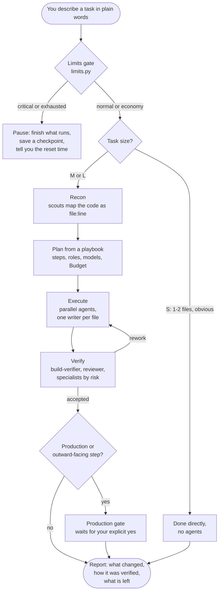

| Task size | Signs | What happens |
|---|---|---|
| **S** | ≤ 2 files, obvious fix, nothing about security, production or protocols | The orchestrator does it itself — no agents |
| **M** | 2–6 steps in 1–2 areas | A short plan, 2–5 agents, verification |
| **L** | Several platforms or services, protocol or security work, production, a batch of audit findings, a new feature | The full cycle, with an architect's review of the plan first |

The rules it plays by:

- **Its own context is the most expensive thing.** Reading and editing are delegated; it works from short `file:line — fact` reports.
- **One writer per file.** Parallel writers on the same build tree get separate git worktrees.
- **Cheapest adequate model first.** On failure the next tier gets the same brief plus the reason.
- **"Done" is never taken on the developer's word.** See the ladder below.
- **Resume, do not re-brief.** A finished or interrupted agent is continued with `SendMessage` and keeps its context.
- **Nothing outward-facing without your "yes".**

<details>
<summary><b>The verification ladder</b> — who checks what</summary>

| The change touches | Checked by |
|---|---|
| anything | `build-verifier` — build, tests, linters |
| code from middle or senior developers | `reviewer` — adversarial: tries to refute "done", runs the build |
| crypto, tokens, wire formats, compatibility | `protocol-reviewer` |
| auth, perimeter, rate limits, production config | `security` |
| user flows, new UI | `qa` (and `accessibility` for UI) |
| behaviour changed without tests | `test-engineer` |
| personal data collected, logged or shared | `privacy-compliance` |
| hot paths | `performance` |
| dependencies change | `dependency-auditor` |
| critical findings | a **refute panel** of 3 independent reviewers; accepted when at least 2 agree |

A "rework" verdict goes back to the **same** developer (context kept), and only the fixes are re-reviewed.

</details>

#### Limit modes

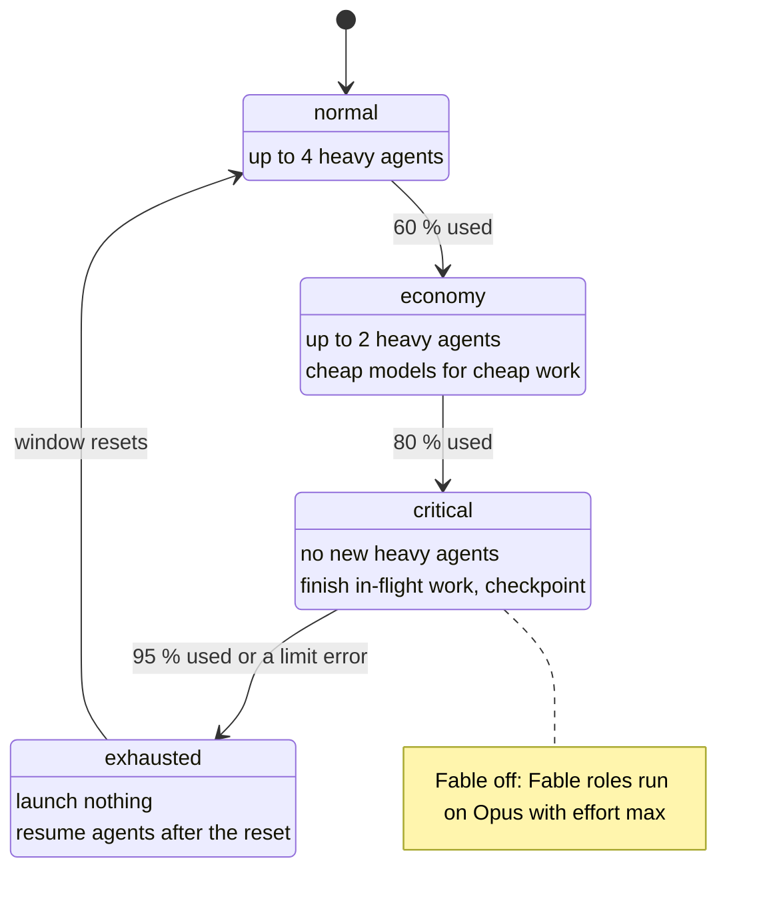

The mode follows your usage: once a window resets and the percentage falls, the mode relaxes back toward `normal`.

#### Context lifecycle

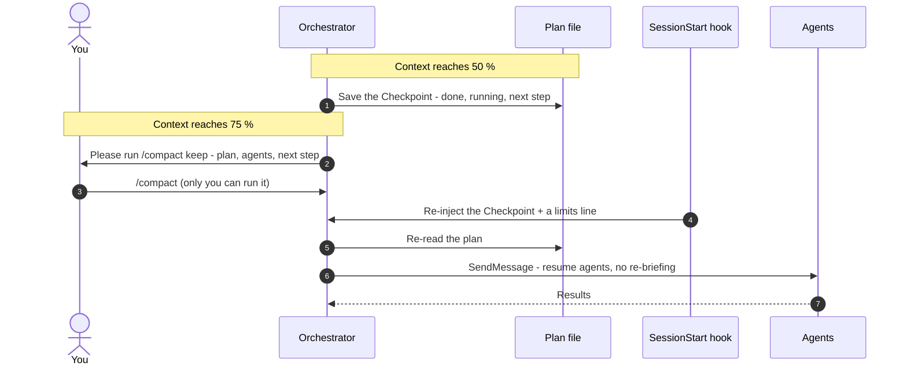

#### The team

<div align="center">

</div>

<a id="en-roles"></a>

<details>
<summary><b>The whole team — all 27 roles</b> (click to open)</summary>

`best` = Fable if your account has it, otherwise Opus. 🆕 = new in 2.0. A role marked "no" in **Writes** is read-only: its editing tools are switched off.

| Group | Role | Agent | Model / effort | Writes | When it is called |
|---|---|---|---|---|---|
| Lead | Architect / tech lead | `orch-architect` | best / high | no | plan or spec review for L tasks; second opinion; judge |
| Lead | Analyst | `orch-analyst` | sonnet / high | no | vague request → requirements and acceptance criteria; docs vs code drift |
| Lead | 🆕 Researcher | `orch-researcher` | sonnet / medium | no | questions that need the web: libraries, standards, prior art — with sources |
| Build | Senior developer | `orch-dev-senior` | opus / high | code | cross-cutting, protocol, concurrency, multi-module changes |
| Build | Middle developer | `orch-dev-middle` | sonnet / medium | code | a well-specified change in one module |
| Build | Junior developer | `orch-dev-junior` | haiku / medium | code | an exact diff, renames, mechanical edits |
| Build | 🆕 Frontend developer | `orch-frontend` | sonnet / medium | code | web UI: components, state, forms, states, responsive layout |
| Build | 🆕 Mobile developer | `orch-mobile` | opus / medium | code | iOS / Android: lifecycle, permissions, secure storage, platform parity |
| Build | 🆕 Database engineer | `orch-db-engineer` | opus / medium | migrations, queries | schemas, safe migrations with rollback, indexes, query plans |
| Build | 🆕 API designer | `orch-api-designer` | sonnet / high | specs | contracts, error model, versioning, compatibility — before code |
| Build | Designer | `orch-designer` | opus / medium | styles, components | screens, design tokens, microcopy |
| Quality | Adversarial reviewer | `orch-reviewer` | opus / high | no | every dev step; tries to refute "done", runs builds |
| Quality | 🆕 Test engineer | `orch-test-engineer` | sonnet / medium | tests | missing tests, coverage gaps, flaky tests, test vectors |
| Quality | QA / user voice | `orch-qa` | sonnet / medium | no | scenarios, smoke checklists, UX traps, false promises in the UI |
| Quality | 🆕 Performance engineer | `orch-performance` | opus / high | code | measured optimisation: profiles, benchmarks, N+1, leaks |
| Quality | 🆕 Accessibility reviewer | `orch-accessibility` | sonnet / medium | no | WCAG 2.2 AA, screen readers, contrast, keyboard, text scaling |
| Quality | Build verifier | `orch-build-verifier` | haiku / low | no | runs the listed commands, PASS / FAIL + error lines |
| Security | Security / pentest | `orch-security` | best / high | no | threat model, auth, perimeter, rate limits, confirming findings |
| Security | Protocol / crypto reviewer | `orch-protocol-reviewer` | best / high | no | crypto, auth tokens, wire formats, cross-platform compatibility |
| Security | 🆕 Privacy engineer | `orch-privacy-compliance` | sonnet / high | no | personal-data map, PII in logs, policy vs behaviour |
| Security | 🆕 Dependency auditor | `orch-dependency-auditor` | sonnet / medium | no | CVEs with reachability, outdated or abandoned packages, licences |
| Ops | DevOps / SRE | `orch-devops` | opus / medium | infra files | snapshots, deploy plans with rollback; production only with `OWNER_APPROVED: yes` |
| Ops | 🆕 Incident responder | `orch-incident-responder` | opus / high | no | production is broken: triage, hypotheses, safe mitigation |
| Ops | 🆕 Release manager | `orch-release-manager` | sonnet / medium | version, changelog | semver bump, release notes, checklist; publishes only with approval |
| Support | Scout | `orch-scout` | haiku / low | no | `file:line` maps; navigating huge documents |
| Support | Tech writer | `orch-tech-writer` | sonnet / medium | docs | README, changelogs, runbooks — every claim checked against the code |
| Support | Toolsmith | `orch-toolsmith` | sonnet / medium | no | finds and vets plugins, skills, MCP, LSP for a domain; never installs |

With a plugin install the agents are addressed as `orchestrator:orch-<role>`; with a manual install, as `orch-<role>`. More on typical teams: [`roles.md`](skills/orchestrator/references/roles.md).

</details>

### <a id="en-limits"></a>Limits, context and costs

<div align="center">

</div>

Before every wave of agents the orchestrator runs `limits.py` (about 1 second, local, read-only) and **follows the `actions` it prints**. You can read the same report any time with `/orchestrator:limits`. The modes are drawn [above](#en-how).

#### The four modes

| Mode | When | What changes |
|---|---|---|
| 🟢 **normal** | below 60 % of the tightest window | Up to 4 heavy (Opus / Fable) agents in parallel; full verification |
| 🟡 **economy** | 60 % and above | Up to 2 heavy agents; Haiku for search and builds, Sonnet for analysis and docs; reviews only for risky diffs; no refute panels |
| 🟠 **critical** | 80 % and above | No new heavy agents; finishes in-flight work, saves a checkpoint, tells you what is done, what is left and when the limit resets |
| 🔴 **exhausted** | 95 % and above, or an active limit error | Launches nothing; saves a checkpoint; after the reset it resumes agents with `SendMessage` — never re-briefs them |

#### When one model runs low

| Status | Trigger | What the orchestrator does |
|---|---|---|
| Fable `economy` | Fable's weekly share ≥ 60 % | Fable is used only as the judge of critical decisions; its other roles run on Opus with effort `max` |
| Fable `off` | A Fable limit error, Fable's weekly share ≥ 85 %, or the session is `critical` | **Every Fable / `best` role runs on Opus with effort `max`** |
| Opus `off` | An Opus limit error | Senior roles run on Sonnet with effort `high` |
| Sonnet `off` | A Sonnet limit error | Analysis and docs go to Haiku `high` or Opus `medium` |

A model's weekly share only counts when a cap for it is known — from `model_weekly_cap_units` in your config, or from a limit message recorded for that model. Otherwise its percentage reads `n/a`, and only the session level or a real limit error can move it.

#### Where the numbers come from (best first)

1. 🎯 **Official numbers from the status line** — Pro/Max: the 5-hour and 7-day `used_percentage` and the reset time; everyone: the context percentage. Used while they are younger than 10 minutes.
2. 📜 **Your local transcripts** (`~/.claude/projects/**`, subagents included), turned into weighted "usage units".
3. ⚠️ **Real limit errors** recorded by Claude Code (`You've hit your … limit · resets …`, `You've used 85% of …`). They calibrate the caps.
4. 🧠 **Self-calibration.** While the official numbers are fresh, it learns how many units make 1 % of each limit and uses that scale when the snapshot gets stale (`cap: calibrated`). It is an approximation between status-line refreshes; fresh official numbers always win.
5. ⚙️ **Your config**, `~/.claude/claude-orchestrator/limits.json` — optional, see [Configuration](#en-config).

Everything except the official numbers is an **estimate**: usage on other devices or on claude.ai is invisible locally. Until a real limit has been seen (and without official numbers) the cap is only a guess — the largest past block — so a high percentage is reported one level milder.

<details>
<summary>See the raw output of limits.py</summary>

```text
mode: ECONOMY
session 5h: 28961327 / 45970360 units (63%, cap: statusline), block 2026-05-04T09:50:00+00:00 -> 2026-05-04T14:50:00+00:00
week 7d:    54933023 / 249695560 units (22%)
model fable   economy  week 21304118 / 30005800 (71%)
model haiku   ok       week 559344 / ? (n/a)
model opus    ok       week 28131516 / ? (n/a)
model sonnet  ok       week 4407242 / ? (n/a)
context: 412880 / 1000000 tokens (41%) -> ok  [3f2a9c1e-….jsonl]
calibration 5h: 1% ≈ 459704 units (learned at 63%, 2026-05-04T12:31Z)
calibration 7d: 1% ≈ 2496956 units (learned at 22%, 2026-05-04T12:31Z)
source: statusline+transcripts
actions:
  - ECONOMY: max 2 parallel heavy agents; no refute panels; prefer haiku for search/build, sonnet for analysis; reviews only for risky changes.
  - FABLE ECONOMY: use fable only as judge for critical/protocol decisions; other fable roles -> opus, effort max.
```

</details>

#### Context

The model cannot run `/compact` or `/clear` — only you can. So the orchestrator keeps its context lean and acts on the fill level:

| Context fill | What it does |
|---|---|
| below 50 % | Nothing special |
| **50 %** and above | Rewrites the plan's `## Checkpoint` (done, running agent ids, next step, open decisions) and stops reading files itself |
| **75 %** and above | Saves the checkpoint, then asks you to run `/compact keep: plan <path>, running agents, next step` |
| after `/compact`, `/clear` or a restart | The `SessionStart` hook puts the checkpoint and a limits line back in front of the model; the orchestrator continues from facts, not from a lossy summary |

#### Costs and budgets

`/orchestrator:costs` turns the same transcripts into a bill **per role and per agent**:

```text
Costs — session 3f2a9c1e · since 2026-05-04 09:52Z · 412 responses
  total: 61.2M tokens · 8.47M units · ≈ 18.4% of the 5-hour limit · ≈ 3.4% of the week

  role                         agents   model   tokens    units   ≈5h %  share
  orchestrator (main)               1    opus    24.1M    3.52M    7.7%    42%
  orch-dev-senior                   2    opus    19.8M    2.61M    5.7%    31%
  orch-reviewer                     2    opus    9.40M    1.37M    3.0%    16%
  orch-tech-writer                  1  sonnet    3.10M   402.5k    0.9%     5%
  orch-security                     1   fable   1.20M    388.0k    0.8%     5%
  orch-scout                        3   haiku    3.60M   121.0k    0.3%     1%
  orch-build-verifier               2   haiku   0.20M    14.2k     0.0%     0%

  top agents:
    orch-dev-senior        a3de429a5d    1.52M units  opus   API + web client for password reset
    orch-reviewer          a0bfb4ae2d    0.81M units  opus   Review backend changes

  budget (2026-05-04-password-reset.md, all sessions since 2026-05-04 16:50): 25% of the 5-hour limit → spent 18.4% = 74% → OK
```

**Plan budgets.** Every plan carries a `Budget:` line in its header. The orchestrator starts from the budget hint of the playbook (for example a medium bugfix 2–6 %, a large feature 20–40 % of the 5-hour limit); you can name your own number in the request or edit the line any time.

| Header line | Meaning |
|---|---|
| `Budget: 25%` | 25 % of the 5-hour limit |
| `Budget: 4M tokens` | 4 million tokens |
| `Budget: 2.5M units` | 2.5 million usage units |

The spend is counted across **all sessions of the project** since `Started:`. The budget hook warns **once at 80 %** and **stops new agents at 100 %**. For example:

```text
[orchestrator budget] plan .claude/plans/2026-05-04-password-reset.md: 82% of the budget (25% of the 5-hour limit) spent. Prefer cheaper models, avoid optional reviews and scope growth; tell the user if the rest will not fit.
```

#### What runs automatically

The plugin ships four hooks on three events. They are **silent while everything is fine** and never break a session.

| When | What it does |
|---|---|
| A session starts | Refreshes the stable copy of the scripts (only if you set up the status line) |
| After `/compact`, `/clear` or resume | Re-injects the plan's checkpoint and a limits line |
| After an agent is launched or finishes | Adds a limits directive, only when the state changed; warns about the plan budget at 80 % / 100 % |
| You send a prompt | Adds a limits directive (cached for 120 seconds), only when the state changed |

A limits message looks like this:

```text
[orchestrator limits] mode=economy session=63% week=22% context=41% models=fable:economy,haiku:ok,opus:ok,sonnet:ok :: ECONOMY: max 2 parallel heavy agents; … | FABLE ECONOMY: …
```

More detail: [docs/en/limits-and-context.md](docs/en/limits-and-context.md).

### <a id="en-commands"></a>Commands

| Plugin install | Manual install | What it does |
|---|---|---|
| `/orchestrator:orchestrator <task>` | `/orchestrator <task>` | **The main command.** Plan → delegate → verify → report |
| `/orchestrator:status` | `/orchestrator status` | Dashboard: plan progress, running agents, next step, limits, spend vs budget |
| `/orchestrator:limits` | `/orchestrator limits` | The limits report, explained |
| `/orchestrator:costs` | `/orchestrator costs` | Tokens per role and agent, top consumers, budget, one saving tip |
| `/orchestrator:resume` | `/orchestrator resume` | Continue the in-progress plan after `/compact`, `/clear`, a restart or a limit reset |
| `/orchestrator:setup` | `./install.sh --statusline` | Turn on the status line (once) |
| `/orchestrator:setup remove` | `./uninstall.sh` | Take our status line and hook entries out again (your data and `limits.json` stay). The manual `./uninstall.sh` removes the whole manual install |

You type the short commands yourself — Claude does not run them on its own. `/orchestrator:status` ends with something like this (from `checkpoint.py --status`):

```text
[orchestrator] status — plan .claude/plans/2026-05-04-password-reset.md (in-progress)
progress: 4 done · 2 in progress · 3 to do  ■■■■◧◧□□□ 44%
```

#### Scripts

The commands above are thin wrappers around small Python and bash scripts. You can run them yourself. They live in the skill folder (`skills/orchestrator/scripts/`); after `/orchestrator:setup` copies of `limits.py`, `costs.py`, `checkpoint.py` and `statusline.py` are also in `~/.claude/claude-orchestrator/`.

| Script | What it does | Useful options |
|---|---|---|
| `python3 limits.py` | The limits report | `--json` · `--hook <Event>` · `--config FILE` · `--context-window N` |
| `python3 costs.py` | Cost report of the current session | `--session <id>` · `--project-wide --since <ISO>` · `--plan <plan.md>` · `--active-plan --budget-only` · `--top N` · `--json` · `--hook PostToolUse` |
| `python3 checkpoint.py` | Prints the checkpoint of the in-progress plan | `--status` (dashboard) · `--hook` |
| `spawn.sh <agent> <brief> --mode …` | Runs an agent in a **separate `claude` process** with a clean context | `--mode headless\|terminal\|tmux\|interactive` · `--model …` · `--effort …` · `--id` · `--max-turns` · `--schema` · `--perm` · `--cwd` |
| `collect.sh [run-id …]` | Collects the results of those runs (default: the 20 latest) | `--wait` · `--full` |

For example, a review on a clean context with Opus at maximum effort (a manual install keeps the scripts in `~/.claude/skills/orchestrator/scripts`):

```bash
echo "Review api/auth.py:10-120 and report problems as file:line" | ~/.claude/skills/orchestrator/scripts/spawn.sh orch-reviewer - --model opus --effort max
```

`headless` runs in the background and writes to `.claude/runs/<run-id>/`; `terminal` and `interactive` open a macOS Terminal window; `tmux` opens a window in a tmux session named `orch`.

### <a id="en-config"></a>Configuration

Everything works with the defaults. To change them, create `~/.claude/claude-orchestrator/limits.json` (`$CLAUDE_CONFIG_DIR` replaces `~/.claude` if you set it). Only the keys you write are changed; the rest keep their defaults. The full template, [`examples/limits.example.json`](examples/limits.example.json):

```json
{
  "session_cap_units": null,
  "weekly_cap_units": null,
  "model_weekly_cap_units": { "fable": null, "opus": null },
  "model_weights": { "fable": 2.0, "opus": 1.0, "sonnet": 0.6, "haiku": 0.2, "other": 1.0 },
  "thresholds": { "economy": 0.60, "critical": 0.80, "exhausted": 0.95 },
  "model_thresholds": { "economy": 0.60, "off": 0.85 },
  "context_window": null,
  "context_thresholds": { "checkpoint": 0.50, "compact": 0.75 }
}
```

| Key | Meaning |
|---|---|
| `session_cap_units` | Pin the 5-hour cap yourself (in usage units) instead of estimating it |
| `weekly_cap_units` | The same for the weekly cap |
| `model_weekly_cap_units` | A weekly cap per model family, e.g. `{ "fable": 5000000 }` |
| `model_weights` | Relative cost weight of each model family: Fable 2.0, Opus 1.0, Sonnet 0.6, Haiku 0.2 |
| `thresholds` | Where `economy`, `critical` and `exhausted` start (shares of a limit) |
| `model_thresholds` | Where a single model goes to `economy` and `off` (shares of its weekly cap) |
| `context_window` | The context size in tokens; automatic when `null` |
| `context_thresholds` | Where the checkpoint (`0.50`) and the `/compact` request (`0.75`) happen |

Example — a more cautious orchestrator with a pinned 5-hour cap:

```json
{
  "session_cap_units": 40000000,
  "thresholds": { "economy": 0.50, "critical": 0.70, "exhausted": 0.90 }
}
```

#### Environment variables

| Variable | Used by | Meaning |
|---|---|---|
| `ORCH_LIMITS_CONFIG` | `limits.py`, `costs.py` | Path to a limits config, instead of the default file |
| `ORCH_STATUSLINE_NEXT` | `statusline.py` | Command of another status line to keep; its output is appended after ` \| `. The installer fills it in when you already had a status line |
| `ORCH_RUNS` | `spawn.sh`, `collect.sh` | Folder for the runs of clean-context agents (default `<project>/.claude/runs`) |
| `ORCH_PERM` | `spawn.sh` | Default permission mode of spawned agents (default `acceptEdits`) |
| `ORCH_WAIT_MAX` | `collect.sh` | The longest `collect.sh --wait` waits, in seconds (default 1800) |
| `CLAUDE_AUTOCOMPACT_PCT_OVERRIDE` | Claude Code itself | Lowers the context percentage at which Claude Code auto-compacts. Not part of this plugin |

### <a id="en-faq"></a>FAQ

<details>
<summary><b>I have no Fable access. Will it work?</b></summary>

Yes, nothing to do. `best` simply means "Fable if your account has it, otherwise Opus". The Fable → Opus fallback only matters if you do have Fable.

</details>

<details>
<summary><b>Subscription or API key — what is the difference?</b></summary>

With a **Pro / Max subscription** the status line gives the *official* 5-hour and weekly percentages, and the orchestrator uses them (and calibrates itself on them). With an **API key** the 5-hour and weekly numbers are *estimates* made from your local transcripts; the context percentage is exact either way.

</details>

<details>
<summary><b>Will it use more tokens than working without it?</b></summary>

Planning and checking cost something, but the design pushes the other way: cheap models do cheap work (scouts and build checks on Haiku), the main chat does not read files (agents return short reports), small tasks are done directly with no team, plans carry budgets, and `economy` mode trims the work when limits get tight. A rough guide per agent (from [`model-routing.md`](skills/orchestrator/references/model-routing.md)): scout 5–50k tokens, build-verifier 5–30k, junior 10–30k, middle 30–100k, senior 60–500k, reviewer 40–300k, architect / protocol / security 60–300k. A plan with five dev steps and full verification: 0.5–1.5M; a cross-platform protocol change with review rounds: 3–7M. `/orchestrator:costs` shows what you actually spent.

</details>

<details>
<summary><b>Is anything sent anywhere?</b></summary>

The scripts are **local**: they only read token counters, model ids, timestamps and limit-error texts from your Claude Code transcripts, and write small state files to `~/.claude/claude-orchestrator/`. They have no network code and there is no telemetry. The agents themselves are ordinary Claude Code subagents: they talk to the Anthropic API like any session, and a few roles (for example `orch-researcher` and `orch-toolsmith`) have web tools.

</details>

<details>
<summary><b>Can I add my own roles?</b></summary>

Yes. Create an agent file — `agents/orch-<name>.md` in a clone, or a file in your project's `.claude/agents/` — with the same frontmatter the built-in ones use (`name`, `description`, `model`, `effort`, `tools`). Then name the role in your request ("use the agent `db-tuner` for the SQL part") or add a row to [`roles.md`](skills/orchestrator/references/roles.md) so the orchestrator considers it every time.

</details>

<details>
<summary><b>Can I use it in one project only?</b></summary>

Yes. In the terminal add `--scope project` (`claude plugin install orchestrator --marketplace newzealandgrom/claude-orchestrator --scope project`), or for a manual install run `./install.sh --project <dir>`.

</details>

<details>
<summary><b>Does it run /compact by itself?</b></summary>

No — only you can run `/compact` and `/clear`; a model cannot. The orchestrator saves a checkpoint at 50 %, asks you at 75 % (with a ready `keep:` line), and the hook restores the checkpoint afterwards.

</details>

<details>
<summary><b>What are "units"?</b></summary>

A weighted token count used to compare usage across models: `units = model weight × (input + 5 × output + 0.1 × cache read + 1.25 × cache write 5m + 2 × cache write 1h)`. Default weights: Fable 2.0, Opus 1.0, Sonnet 0.6, Haiku 0.2. Percentages shown to you are shares of a limit; units only matter if you pin caps in the config.

</details>

<details>
<summary><b>Windows?</b></summary>

Use WSL (Ubuntu): the scripts are bash and Python 3. See Step 1 of the install. Run Claude Code and the plugin inside the Ubuntu window.

</details>

<details>
<summary><b>I used v1 ("Team Orchestrator"). What changed?</b></summary>

The plugin was renamed to `orchestrator`, the team grew from 15 to 27 roles, and there are new short commands, playbooks, cost tracking with budgets and self-calibration. The command `/team-orchestrator` is now `/orchestrator:orchestrator` (plugin) or `/orchestrator` (manual). Migration steps are right below.

</details>

### <a id="en-update"></a>Update · Uninstall · Migrate from v1

#### Update

💬 In Claude Code, refresh the marketplace, then update the plugin (or use the `/plugin` menu):

```
/plugin marketplace update claude-orchestrator
```

```
/plugin update orchestrator@claude-orchestrator
```

🖥️ Or from the terminal:

```bash
claude plugin update orchestrator@claude-orchestrator
```

Manual install — in the clone (the same options as before):

```bash
git pull && ./install.sh
```

#### Uninstall

**1.** First undo the status line. 💬 In Claude Code (this takes Orchestrator's status line and hook entries out of `~/.claude/settings.json` and restores your previous status line; your data folder `~/.claude/claude-orchestrator/` stays):

```
/orchestrator:setup remove
```

**2.** Then remove the plugin. 💬 In Claude Code:

```
/plugin uninstall orchestrator@claude-orchestrator
```

🖥️ Or from the terminal:

```bash
claude plugin uninstall orchestrator@claude-orchestrator
```

Forgot step 1? Delete the `statusLine` entry in `~/.claude/settings.json` (a backup was made at setup), or run `./uninstall.sh` from a clone. The data folder `~/.claude/claude-orchestrator/` is left in place by both steps — delete it by hand if you do not need it. **Manual installs:** `./uninstall.sh` removes the skill, the `orch-*` agents, `~/.claude/claude-orchestrator`, and only our own status line and hook entries — your previous status line is restored.

#### Migrate from v1

v1 was called "Team Orchestrator" (plugin `team-orchestrator`). 💬 In Claude Code, remove it and its marketplace:

```
/plugin uninstall team-orchestrator@team-orchestrator
```

```
/plugin marketplace remove team-orchestrator
```

Then install v2 as in [Step 3](#en-install).

**Manual v1 install** — in your clone:

```bash
git pull && ./install.sh
```

It removes the old skill folder and migrates the v1 status line and hook entries in `settings.json` to v2 automatically (your own status line is kept). Your data moved from `~/.claude/team-orchestrator/` to `~/.claude/claude-orchestrator/` (the old status snapshot is still read as a fallback).

### <a id="en-repo"></a>Repository

```text
.claude-plugin/plugin.json, marketplace.json
skills/orchestrator/SKILL.md                       main skill (/orchestrator:orchestrator)
skills/orchestrator/references/                    playbooks, roles, limits-and-context, model-routing, verification, parallelism, production-gate, project-map-template
skills/orchestrator/templates/                     plan.md, brief.md
skills/orchestrator/scripts/                       limits.py, costs.py, statusline.py, checkpoint.py, spawn.sh, collect.sh
skills/status|limits|costs|resume|setup/SKILL.md   short commands (/orchestrator:status …)
agents/orch-*.md                                   27 roles
hooks/hooks.json                                   4 hooks on 3 events
scripts/patch_settings.py, sync_stable.py          installer helpers
install.sh, uninstall.sh                           manual install / status line
examples/                                          sample plan, brief, session walkthroughs, outputs, prompts, limits config
docs/en, docs/ru                                   usage guide, limits & context
assets/                                            SVG graphics
```

**Docs:** [Usage guide](docs/en/usage-guide.md) · [Limits and context](docs/en/limits-and-context.md) · [Playbooks](skills/orchestrator/references/playbooks.md) · [Changelog](CHANGELOG.md)

**Contributing.** Issues and pull requests are welcome. Keep the scripts standard-library only (Python 3.9+), note user-visible changes in [`CHANGELOG.md`](CHANGELOG.md), and run this before you submit:

```bash
claude plugin validate --strict .
```

**License.** MIT — see [`LICENSE`](LICENSE).

</details>
